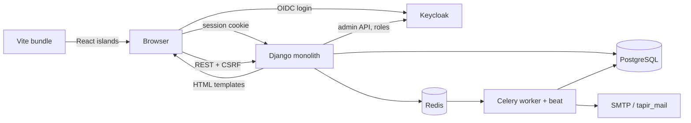
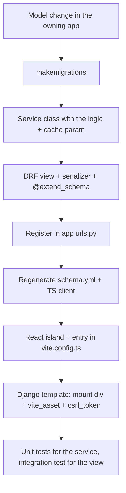

# Developer documentation

Entry point for developers and AI coding agents working on Tapir.
Language is English on purpose: the code, [AGENTS.md](../../AGENTS.md) and the generated API clients are English.
Admin/operator documentation is German and lives in [doc/](../README.md).

> Setup, test and formatting commands are **not** repeated here — see [README.md](../../README.md).
> The repo/app map is **not** repeated here — see [AGENTS.md](../../AGENTS.md).

## Map

| Document | Read it when |
|---|---|
| [architecture.md](architecture.md) | You touch backend code: layering, services, the `cache` contract, permissions, Celery, parameters |
| [frontend.md](frontend.md) | You touch React/TypeScript: the Django↔React bridge, entry points, generated API client |
| [domain-model.md](domain-model.md) | You touch models or business rules: entities, date-ranged data, money |
| [testing.md](testing.md) | You write or fix tests |
| [operations.md](operations.md) | You change settings, env vars, Docker, Keycloak, mail or deployment |
| [security.md](security.md) | Always skim before a PR; mandatory for anything touching auth, money, PII, uploads or exports |

Short, enforceable rules for agents live in [.github/instructions/](../../.github/instructions/) and are loaded automatically per file type.

## The system in one picture

Tapir is a **Django monolith that renders HTML**, with **React islands** mounted into specific `
`s of those templates.
There is no SPA and no separate API gateway. React talks back to the same Django instance over DRF endpoints using the
session cookie plus a CSRF header.

## Ten facts that explain most of the codebase

1. **Business logic lives in `tapir/<app>/services/`**, not in views or models. Views parse/serialize, services decide.
2. **All models inherit `TapirModel`** ([tapir/core/models.py](../../tapir/core/models.py)) → 10-char nanoid primary keys, `created_at`, `updated_at`.
3. **`cache: dict` is a per-request query cache**, created at the entry point and threaded through every service call. It is *not* Redis. See [architecture.md](architecture.md#the-cache-contract).
4. **Permissions are Keycloak roles, not Django permissions.** `user.has_perm("coop.manage")` checks a Keycloak role name. The `auth_permission` table is unused.
5. **`tapir/wirgarten/` is legacy.** It holds the central models (`Member`, `Subscription`, `Product`…) but violates every convention above. New code goes into the other apps.
6. **Almost all domain data is date-ranged** (`valid_from`, `start_date`/`end_date`, `valid_at`). "Current" is always a query, never a flag. This is the #1 source of bugs — see [domain-model.md](domain-model.md#temporal-data-the-main-pitfall).
7. **Every React island is an entry point** registered in [vite.config.ts](../../vite.config.ts) and loaded by a Django template tag. Forgetting either half fails silently.
8. **The TypeScript API client is generated** from `schema.yml`, which is generated from DRF views. Change a view → regenerate both.
9. **Scheduled business processes run in Celery beat** (renewals, monthly payments, mails) — defined in [tapir/settings/deployment.py](../../tapir/settings/deployment.py).
10. **Runtime behaviour is configurable via `TapirParameter`** (DB-backed settings/feature flags), not via Django settings.

## Where to start

**Good first tasks:** issues labelled *Ready to be worked on*, ideally inside a non-legacy app
(`subscriptions/`, `payments/`, `pickup_locations/`, `waiting_list/`, `associations/`).

**Read in this order:**

1. [tapir/core/models.py](../../tapir/core/models.py) and [tapir/utils/services/tapir_cache.py](../../tapir/utils/services/tapir_cache.py) — the two primitives everything is built on.
2. One complete vertical slice, e.g. `tapir/pickup_locations/` (`models.py` → `services/` → `views.py` → `serializers.py` → `urls.py` → `tests/`).
3. The matching frontend island, e.g. `src_frontend/pickup_location_config/`.
4. [tapir/wirgarten/models.py](../../tapir/wirgarten/models.py) — the domain core, unavoidable.

### Adding a feature: the standard path

Step by step:

1. **Model** — put it in the app that owns the concept, never in `wirgarten/` for new concepts. Inherit `TapirModel`.
2. **Service** — a class with `@classmethod`s, named `<Verb><Noun>` (e.g. `WaitingListEntryCreator`). Take `cache: dict` as a **required** parameter and pass it on.
3. **View** — DRF `APIView`/`ViewSet`. Set `permission_classes` explicitly, create `cache = {}` in `__init__` or at the top of the handler, annotate with `@extend_schema`.
4. **Route** — register in the app's `urls.py` (router for CRUD, `path()` for custom actions).
5. **Regenerate** the schema and TS client (command in [README.md](../../README.md)); commit both.
6. **Frontend** — folder in `src_frontend/<feature>/` with a `<feature>_entry.tsx`, registered in [vite.config.ts](../../vite.config.ts).
7. **Template** — mount `
`, ``, ``, ``.
8. **Tests** — service logic as unit tests, endpoint + permissions as an integration test.

### Non-negotiables

- Never put business logic in a view, a model method that reaches beyond its own fields, or a serializer.
- Never trust prices, amounts or member ids from the client — recompute server-side, and authorize object access.
- Never hand-edit `schema.yml` or `src_frontend/api-client/`.
- Never create users in `setUpTestData` (Keycloak mocking happens in `setUp`).
- Never widen an endpoint to `permission_classes = []` without an explicit alternative check.
