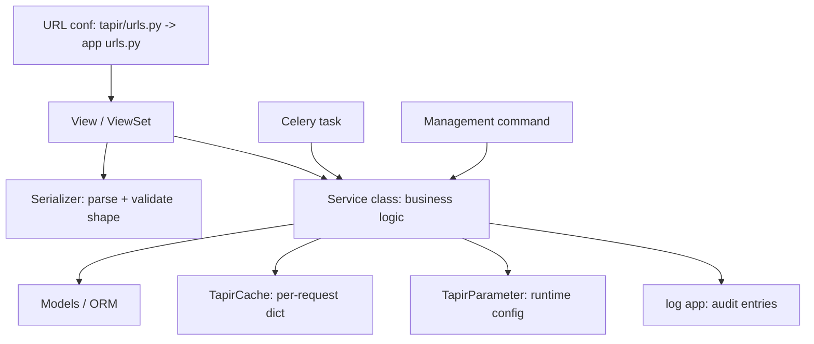
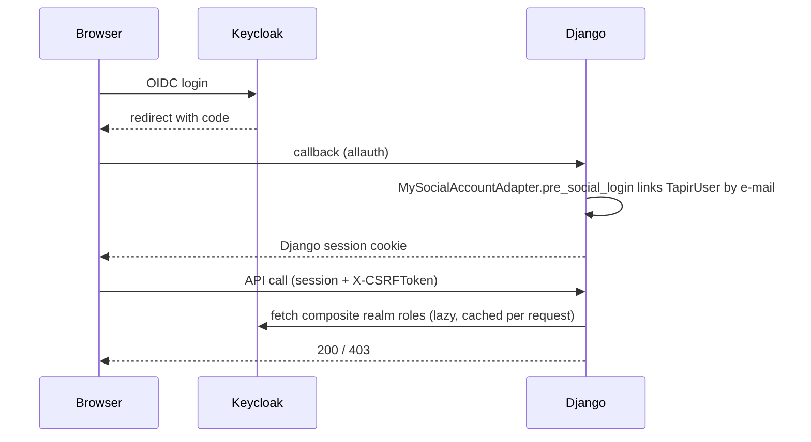

# Backend architecture

Django 6 + DRF monolith. App responsibilities are listed in [AGENTS.md](../../AGENTS.md); this document explains how the
layers interact and which rules hold across all apps.

## Layering



| Layer | Allowed to do | Must not do |
|---|---|---|
| View | auth checks, parse request, create the `cache` dict, call services, return `Response` | contain business rules, run multi-step ORM logic |
| Serializer | shape validation, field-level checks | cross-entity business validation, DB writes with side effects |
| Service | all business logic, orchestration, transactions | know about `request`/HTTP (pass plain values instead) |
| Model | own fields, trivial helpers over own fields | query other entities, compute domain rules |

The only consumer-agnostic layer is the service layer — that is why views, Celery tasks and management commands can all
call the same code.

## Request lifecycle

Root conf: [tapir/urls.py](../../tapir/urls.py) includes one `urls.py` per app. Apps mix two styles:

- DRF `DefaultRouter` + `ViewSet` for resource CRUD.
- Plain `path()` + `APIView` for custom actions, and `path()` + Django CBVs for server-rendered admin pages.

Middleware order is defined in [tapir/settings/base.py](../../tapir/settings/base.py). Custom entries worth knowing:

| Middleware | Location | Effect |
|---|---|---|
| `language_middleware` | [tapir/accounts/models.py](../../tapir/accounts/models.py) | Activates `user.preferred_language` (default `de`) per request |
| `GlobalServerErrorHandlerMiddleware` | [tapir/wirgarten/middleware/error.py](../../tapir/wirgarten/middleware/error.py) | Catches unhandled exceptions and writes them to `ERROR_LOG_DIR` |
| `TapirMailPermissionMiddleware` | [tapir/wirgarten/middleware/mailing.py](../../tapir/wirgarten/middleware/mailing.py) | Guards the embedded `tapir_mail` routes with `email.manage` |

DRF defaults ([tapir/settings/base.py](../../tapir/settings/base.py)): authentication = Token, Session and
`DrfForwardAuthentication` ([tapir/accounts/drf_authentication.py](../../tapir/accounts/drf_authentication.py), which
forwards the Django session user); default permission = `IsAuthenticated`.

## Authentication and authorization

Identity lives in **Keycloak**, wired through `django-allauth`'s OpenID Connect provider.



Key pieces:

- [tapir/accounts/adapter.py](../../tapir/accounts/adapter.py) — links an existing `TapirUser` to a Keycloak account by e-mail and stores `keycloak_id`.
- [tapir/accounts/services/keycloak_user_manager.py](../../tapir/accounts/services/keycloak_user_manager.py) — user lifecycle in Keycloak, role lookup, admin client (cached in the request `cache`).
- [tapir/accounts/models.py](../../tapir/accounts/models.py) — `KeycloakUser.has_perm()` returns `perm in self.roles`, i.e. **Keycloak role names are the permission strings**. Django groups/permissions are not used. On logout, a signal terminates the Keycloak session.
- [tapir/wirgarten/constants.py](../../tapir/wirgarten/constants.py) — the `Permission` class, the single source of permission strings: `coop.view|manage`, `accounts.view|manage`, `payments.view|manage`, `products.view|manage`, `email.manage`.
- [tapir/wirgarten/utils.py](../../tapir/wirgarten/utils.py) — `check_permission_or_self(pk, request)`, the object-level check used by all member-scoped endpoints.

> **In tests, `has_perm()` falls back to `is_superuser`** — permission bugs can therefore pass tests that log in as admin.
> Always add a test with a non-privileged member for member-scoped endpoints.

Enforcement styles in use (all three are valid, pick the one matching the view type):

```python
class ParameterView(PermissionRequiredMixin, generic.FormView):   # Django CBV
    permission_required = "coop.manage"

class ProductViewSet(viewsets.ReadOnlyModelViewSet):              # DRF
    permission_classes = [permissions.IsAuthenticated, HasCoopManagePermission]

def get(self, request):                                           # manual, inside APIView
    if not request.user.has_perm(Permission.Products.VIEW):
        return Response(status=status.HTTP_403_FORBIDDEN)
```

See [security.md](security.md) before writing a public endpoint.

## Service classes

Shape (see [tapir/waiting_list/services/](../../tapir/waiting_list/services/),
[tapir/bestell_wizard/services/](../../tapir/bestell_wizard/services/),
[tapir/subscriptions/services/](../../tapir/subscriptions/services/)):

```python
class WaitingListEntryCreator:
    @classmethod
    def create_entry_existing_member(cls, order, member: Member, cache: dict):
        ...
```

- One class per cohesive operation; `@classmethod`s only, no instance state.
- Name says what it does: `...Creator`, `...Validator`, `...Calculator`, `...Builder`, `...Provider`.
- `cache: dict` is **required** in new code and passed down to every nested service call.
- No `request` object: pass the already-extracted values.

## The cache contract

`cache` is a plain dict that deduplicates DB queries **within one request/task**. It has nothing to do with Redis
(Redis is only the Celery broker and the Django `CACHES` backend).

- Helpers: `get_from_cache_or_compute()` in [tapir/utils/shortcuts.py](../../tapir/utils/shortcuts.py).
- Shared accessors: [tapir/utils/services/tapir_cache.py](../../tapir/utils/services/tapir_cache.py) (e.g. `TapirCache.get_all_subscriptions(cache)`).
- Invalidation: [tapir/utils/services/tapir_cache_manager.py](../../tapir/utils/services/tapir_cache_manager.py) — accessors register their key under a category (`CATEGORY_SUBSCRIPTIONS`, …); `TapirCacheManager.clear_category(cache, category)` drops them.

Rules:

1. Create exactly **one** dict per request/task/command, at the outermost layer. Never create a fresh `{}` deeper down — that silently defeats the cache and can return stale-free but N+1 results.
2. After a write that changes cached data (e.g. creating a subscription) **within the same request**, clear the affected category, otherwise subsequent reads return pre-write values.
3. Never store a `cache` dict in a module-level variable, on a class, or across requests. It is deliberately short-lived and has no TTL or invalidation beyond the above.

## Runtime configuration: TapirParameter

DB-backed settings and feature flags, not Django settings.

- Model + typed value parsing: [tapir/configuration/models.py](../../tapir/configuration/models.py)
- Definition/read API: [tapir/configuration/parameter.py](../../tapir/configuration/parameter.py) — `parameter_definition(...)`, `get_parameter_value(key, cache)`
- Definitions grouped per topic, e.g. [tapir/wirgarten/parameters.py](../../tapir/wirgarten/parameters.py) (`ParameterDefinitionsBusiness`, `...Payments`, `...Subscriptions`, …)
- Adding a parameter: declare it in the matching `ParameterDefinitions*` class, then run `python manage.py parameter_definitions` to materialise it in the DB. A parameter that is only declared in code does not exist at runtime.
- Read it with the request `cache` so all parameters are fetched once.

## Background jobs

[tapir/celery.py](../../tapir/celery.py) autodiscovers `tasks.py` per app and mails admins on task failure.
`CELERY_BEAT_SCHEDULE` in [tapir/settings/deployment.py](../../tapir/settings/deployment.py) drives the business
calendar — subscription and solidarity renewals, monthly payment creation, membership mails, mail dispatch batches,
cleanup jobs.

Implications: anything on that schedule is **production business logic**, so it must live in a service class, be
idempotent (a retried task must not double-charge), and create its own `cache` dict.

## Audit log

[tapir/log/models.py](../../tapir/log/models.py) uses single-table inheritance via `ContentType`:

- `TextLogEntry` — free-text note.
- `UpdateModelLogEntry` — diff of changed fields in two `HStoreField`s; subclasses declare `excluded_fields` (e.g. `UpdateTapirUserLogEntry` excludes `password`).

Pattern: `UpdateTapirUserLogEntry().populate(old_model=..., new_model=..., actor=request.user, user=member.user).save()`.
Log every admin-initiated change to member data, and never log secrets or full bank details.

## Legacy boundary: `tapir/wirgarten/`

It contains the central models and a lot of view-level business logic, mail wiring and admin pages.
When you must change it:

- Extract the part you touch into a service in the owning non-legacy app and call it from the legacy view.
- Do not add new models there; add them to a domain app and point FKs at the legacy models.
- Expect function-based views, logic in templates, and module-level side effects.

## Pitfalls

| Pitfall | Consequence |
|---|---|
| Creating a second `cache` dict deeper in the stack | N+1 queries, and stale/fresh mismatch after writes |
| Assuming Django permissions/groups work | `user.has_perm()` silently checks Keycloak roles; DB permissions are ignored |
| Testing permissions only as admin | `has_perm()` is short-circuited for superusers in tests |
| Adding a DRF view without `@extend_schema` | Useless generated TS client, broken frontend typing |
| Forgetting `python manage.py parameter_definitions` after adding a parameter | `get_parameter_value()` fails or returns nothing at runtime |
| Business logic in a view | Not reusable from Celery/commands, untestable without HTTP |
| Side effects in `AppConfig.ready()` | e.g. `configure_mail_module()`; import order matters, failures are obscure |
| Signals in unexpected places (logout → Keycloak, waiting list → mail triggers) | Writes trigger remote calls; there is no central signal registry, grep for `@receiver` |
| Environment-dependent e-mail backend | In dev, mails are written to files instead of being sent — see [operations.md](operations.md) |
