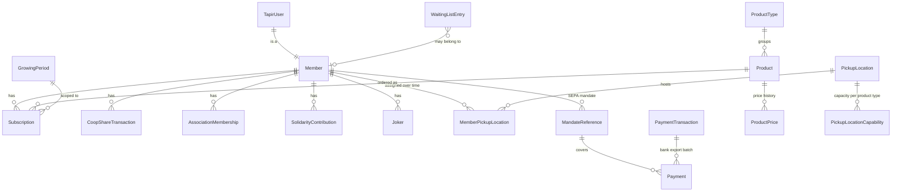

# Domain model

Business domain: community supported agriculture (CSA). Members buy **cooperative shares** (capital) and subscribe to
**products** (weekly harvest/bread shares) for a **growing period**, picked up at a **pickup location** and paid by
**SEPA direct debit**.

Most core models still live in the legacy module [tapir/wirgarten/models.py](../../tapir/wirgarten/models.py); newer
concepts have their own apps.

## Entity map

| Entity | Location | Meaning |
|---|---|---|
| `TapirUser` | [tapir/accounts/models.py](../../tapir/accounts/models.py) | Auth identity, mirrors a Keycloak user (`keycloak_id`) |
| `Member` | [tapir/wirgarten/models.py](../../tapir/wirgarten/models.py) | A `TapirUser` with member data: IBAN, consents, member number |
| `ProductType` / `Product` / `ProductPrice` | wirgarten | Category (delivery cycle, rules) / variant / dated price + `size` |
| `Subscription` | wirgarten | Order of a product for a date range, with trial, notice period, cancellation, optional price override |
| `GrowingPeriod` | wirgarten | Annual cycle; weeks without delivery, joker limits |
| `CoopShareTransaction` | wirgarten | Purchase/cancellation/transfer of cooperative shares, effective at `valid_at` |
| `MandateReference` / `Payment` / `PaymentTransaction` | wirgarten, [tapir/payments/](../../tapir/payments/) | SEPA mandate, single due amount, bank export batch |
| `PickupLocation`, `PickupLocationCapability` | wirgarten, [tapir/pickup_locations/](../../tapir/pickup_locations/) | Pickup point, capacity per product type |
| `Joker` | [tapir/deliveries/models.py](../../tapir/deliveries/models.py) | Coupon to skip one delivery |
| `SolidarityContribution` | [tapir/solidarity_contribution/](../../tapir/solidarity_contribution/) | Income-based extra/reduced contribution over a date range |
| `AssociationMembership` | [tapir/associations/](../../tapir/associations/) | Membership in the association, possibly open-ended |
| `WaitingListEntry` | [tapir/waiting_list/](../../tapir/waiting_list/) | Signup queue with location/product wishes; may precede membership |
| `TapirParameter` | [tapir/configuration/](../../tapir/configuration/) | Runtime configuration / feature flags |

## Concepts you must understand before changing business logic

- **Coop share vs subscription** — a share is a one-time capital stake in the cooperative; a subscription is a recurring service. Products may require a minimum number of shares.
- **Growing period** — defines which products exist, how many jokers a member gets, and which weeks have no delivery. Renewal is always "per growing period".
- **Trial period** — the initial phase of a subscription or solidarity contribution; `trial_disabled` and `trial_end_date_override` modify it. Cancellation rules differ inside the trial.
- **Notice period** — `notice_period_duration` + `notice_period_unit` on the subscription; services derive the effective cancellation date from it. `cancellation_ts` records *when the member cancelled*, the subscription still runs until its computed end.
- **Capacity** — `ProductPrice.size` expresses a product in "equivalent share units"; a subscription consumes `size × quantity` of the pickup location's capability for that product type.
- **Jokers** — limited per growing period; may produce a `MemberCredit` as compensation.

## Temporal data: the main pitfall

Almost nothing is "current" by flag; it is current *relative to a date*.

| Pattern | Models | How to resolve "now" |
|---|---|---|
| `valid_from` only, no end | `ProductPrice`, `MemberPickupLocation`, `TaxRate` | `filter(valid_from__lte=date).order_by("-valid_from").first()` — **not** a range query |
| `valid_at` (future-dated effect) | `CoopShareTransaction` | Only count rows with `valid_at__lte=date`; future purchases must not be counted yet |
| `start_date` / `end_date` | `Subscription`, `AssociationMembership`, `SolidarityContribution` | `start_date__lte=date` and (`end_date__gte=date` or `end_date__isnull=True`) |

Rules:

1. Service functions take an optional `reference_date`, defaulting to `get_today()`. Use it instead of `datetime.date.today()` so tests can travel in time.
2. `cancellation_ts` set ≠ inactive. Always evaluate the date range *and* the cancellation.
3. A nullable `end_date` means "open ended", not "ended".
4. When you edit a dated record, you normally **insert a new row with a later `valid_from`**, you do not update the old one — otherwise history and past invoices change retroactively.
5. Resolving current prices/locations in a loop is the classic N+1 generator; use the `cache` accessors in [tapir/utils/services/tapir_cache.py](../../tapir/utils/services/tapir_cache.py).

## Money

- All amounts are `DecimalField(max_digits=8, decimal_places=2)`. Never convert to `float` for arithmetic.
- Currency is EUR throughout; formatting helpers live in [tapir/wirgarten/utils.py](../../tapir/wirgarten/utils.py).
- `TaxRate` (per product type, `valid_from`) is used to *derive* the tax portion from a gross price; it does not change the amount charged.
- Prices are always recomputed server-side from the DB (`SubscriptionPriceCalculator`, `DeliveryPriceCalculator` in [tapir/subscriptions/services/](../../tapir/subscriptions/services/)). Client-supplied amounts are input for validation only — see [security.md](security.md).

## Migrations

- `tapir/wirgarten/` carries a long history (130+ migrations) including merge migrations from parallel branches. Expect conflicts there and resolve with a merge migration rather than rewriting history.
- Keep migrations for new apps in their own app; do not add fields to legacy models unless there is no alternative.
- Field removals in the legacy app were destructive in the past (e.g. the old percentage-based solidarity price). When removing a field that holds business data, add a data migration first.
- Always run `makemigrations --check` mentally: a model change without a committed migration breaks every other developer's DB.
