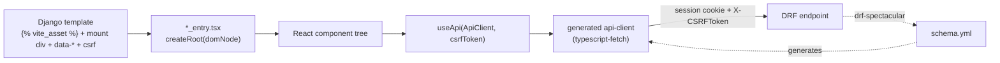

# Frontend & the Django↔React bridge

React 19 + TypeScript, bundled by Vite, embedded into Django templates as **islands**. There is no router, no SPA shell
and no global store.

## The bridge



Four things must line up, or the island silently does nothing:

| # | Thing | Where |
|---|---|---|
| 1 | Entry file `*_entry.tsx` | `src_frontend/<feature>/` |
| 2 | Entry registered in `rollupOptions.input` | [vite.config.ts](../../vite.config.ts) |
| 3 | `` + `` | the Django template |
| 4 | Mount `<div id="...">` with `data-*` attributes, ``, `` | the Django template |

In dev mode additionally `` and ``, otherwise there is no hot reload.

## Passing data Django → React

Two channels only:

- **`data-*` attributes** on the mount node, read via `domNode.dataset.*`. Everything is a string — booleans arrive as `"true"`.
- **`window._env_`**, filled by ``
  ([tapir/core/templatetags/core.py](../../tapir/core/templatetags/core.py), template in `tapir/core/templates/core/tags/`)
  and read through [src_frontend/env.ts](../../src_frontend/env.ts). It carries `REACT_APP_API_ROOT` (derived from the
  request host) and the tapir-mail base paths.

## Entry point pattern

```tsx
import { createRoot } from "react-dom/client";
import { getCsrfToken } from "../utils/getCsrfToken.ts";
import Feature from "./Feature.tsx";

const domNode = document.getElementById("feature_root");
if (domNode) {
  createRoot(domNode).render(
    <Feature memberId={domNode.dataset.memberId!} csrfToken={getCsrfToken()} />,
  );
} else {
  console.error("Failed to render feature from React");
}
```

- The CSRF token always travels as a prop from the entry point down to the components that call the API.
- One template may host several independent roots (see `src_frontend/member_profile/member_profile_entry.tsx`).
- There are **no error boundaries and no context providers** in entries today — a render error only shows in the console.

## API access

[src_frontend/hooks/useApi.ts](../../src_frontend/hooks/useApi.ts) is the single place that configures the generated
client: `basePath` from `env.REACT_APP_API_ROOT`, header `X-CSRFToken`, `credentials: "include"`. Use it; do not call
`fetch()` directly, or you lose CSRF and cookies.

Data fetching is plain `useEffect` + `useState` with an explicit `isLoading` and `error` state. No React Query, Redux or
Zustand. Keep that style for consistency.

## Regenerating the API client

`src_frontend/api-client/` is **generated** (OpenAPI Generator `typescript-fetch`, pinned in
[openapitools.json](../../openapitools.json)) and committed. After every change to a DRF view, serializer or
`@extend_schema` annotation:

```bash
docker compose exec web ./scripts/generate_api_schema.sh \
  && docker compose exec vite ./scripts/generate_api_clients.sh
```

Commit `schema.yml` together with the regenerated client. [scripts/generate_api_clients.sh](../../scripts/generate_api_clients.sh)
skips work when the schema hash is unchanged, so a forgotten schema regeneration looks like "nothing happened".

## Conventions

- **No path aliases.** Relative imports only, with explicit `.ts`/`.tsx` extensions.
- **UI**: react-bootstrap / Bootstrap 5; shared widgets in [src_frontend/components/](../../src_frontend/components/) (`TapirButton`, `TapirDateInput`, `ConfirmModal`, `EmailInput`, pagination…). Check there before building a new one.
- **Dates**: `dayjs` with German locale. Strings from the API are ISO-8601; a date-only field parses as UTC midnight, which shifts a day in local time if you format it naively.
- **Language**: user-facing strings are German, code and comments English.
- **TypeScript**: `strict: true` ([tsconfig.app.json](../../tsconfig.app.json)); `noUnusedLocals`/`noUnusedParameters` are off.
- **Formatting**: Prettier with `prettier-plugin-organize-imports`.

## Pitfalls

| Symptom | Cause |
|---|---|
| Island renders nothing, no error | Entry not registered in [vite.config.ts](../../vite.config.ts), or the mount `id` does not match |
| 403 on every POST/PUT/DELETE | `` missing in the template, so `getCsrfToken()` returns `""` |
| Requests go to `undefined/...` or fail CORS | `` missing → `window._env_` undefined |
| TS compiles but the call 404s or returns the wrong shape | Stale generated client — regenerate schema **and** client |
| No hot reload | `` / `` missing, or `DJANGO_VITE_DEBUG` not set |
| Works in dev, 404 for assets in prod | Production serves from `dist/` via the manifest — the bundle must be built and `collectstatic` run |
| Date off by one day | Date-only values parsed as UTC midnight then rendered in local time |
| `pnpm lint` fails to start | No `eslint.config.js` is committed; ESLint 9 requires a flat config |
