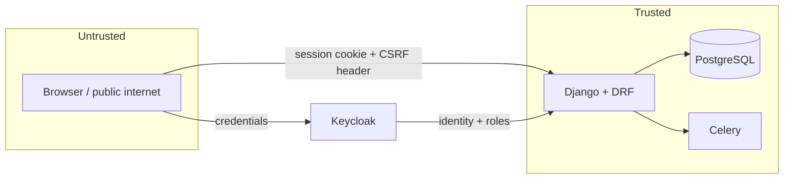

# Security-sensitive areas

Tapir holds member master data, bank details (IBAN/SEPA mandates) and money movements. Treat the regions below as
review-mandatory: a change there needs a second pair of eyes and a test for the failure case.

> Installation-specific findings and hardening notes are kept out of the repository in `doc/dev/security-internal.md`
> (git-ignored, shared out of band). This file only contains what is safe to publish.

## Trust boundaries

- **Keycloak is the identity authority.** Django trusts the session that allauth created and the roles Keycloak reports. A compromised Keycloak admin client means full compromise of Tapir.
- **Everything from the browser is untrusted**, including ids, prices, quantities and dates — also from the order wizard, which is intentionally public.
- **Django trusts its own DB.** Data written by an import or a management command is not re-validated later.

## Regions that need extra attention

| Region | Invariant that must hold |
|---|---|
| [tapir/accounts/](../../tapir/accounts/) (adapter, `KeycloakUserManager`, `has_perm`) | Role lookup and account linking are the entire authorization basis. `has_perm` falls back to `is_superuser` **in tests** — never conclude from a green test that authorization works. |
| [tapir/wirgarten/utils.py](../../tapir/wirgarten/utils.py) → `check_permission_or_self` | Every endpoint that receives a `member_id` from URL, query or body must authorize it before loading data. Object ownership is never implied by a valid id. |
| Views with `permission_classes = []` | Only acceptable with a documented alternative control (unguessable link token, or `check_permission_or_self` inside the handler). Adding one is a design decision, not a shortcut. |
| [tapir/payments/](../../tapir/payments/), [tapir/subscriptions/services/](../../tapir/subscriptions/services/), [tapir/bestell_wizard/](../../tapir/bestell_wizard/) | Prices, solidarity amounts, share counts and capacities are **recomputed server-side** from the DB. Client input may select a product, never set a price. Payment creation must be idempotent. |
| SEPA data on `Member` (IBAN, account owner, consent timestamps) | Only reachable with `payments.manage`/`accounts.manage` or by the member themselves; consent timestamps are append-only evidence — never silently overwrite them. |
| [tapir/generic_exports/](../../tapir/generic_exports/) (CSV/PDF) | Exports concentrate PII. Generation and download must both be permission-checked; generated files must not become publicly guessable URLs, and should be retained only as long as needed. |
| `filepond_temp_uploads/`, `filepond_stored_uploads/` | Uploads are untrusted content. Validate type and size, store outside the static root, and serve through an authorized view with `Content-Disposition: attachment`. |
| [tapir/waiting_list/](../../tapir/waiting_list/) public confirmation endpoints | Link-token authorization: tokens must be cryptographically random, single-purpose and ideally expiring. The endpoint returns personal data, so token strength *is* the access control. |
| [tapir/log/](../../tapir/log/) | Log who changed what, but never passwords, tokens or full bank details. Subclasses declare `excluded_fields`. |
| [tapir/configuration/](../../tapir/configuration/) (`TapirParameter`) | Parameters change business behaviour at runtime; write access is an administrative privilege, and parameter values may end up in templates and mails. |
| [src_frontend/hooks/useApi.ts](../../src_frontend/hooks/useApi.ts) | Single place that attaches the CSRF header and cookies. Bare `fetch()` calls bypass it and will either break or weaken CSRF protection. |

## Rules for new code

1. **Authorize explicitly.** Set `permission_classes` on every DRF view; call `check_permission_or_self` whenever a member id comes from the request.
2. **Recompute, never accept.** Any money, capacity or entitlement value arriving from the client is a *request*, not a fact.
3. **Declare serializer fields.** Prefer explicit `fields = [...]` over `fields = "__all__"`; where `__all__` is used, mark `id`, timestamps and status fields read-only so they cannot be set through the API.
4. **Keep secrets in the environment.** No credentials, tokens or production hosts in code, fixtures or templates.
5. **Escape by default.** Django auto-escaping stays on; no `mark_safe`/`|safe` on user-controlled data, no `dangerouslySetInnerHTML` in React.
6. **No raw SQL** outside migrations; use the ORM so parameters are bound.
7. **Log admin actions** on member data through the `log` app.
8. **Think about enumeration** on public endpoints: ids, member numbers and e-mail addresses should not be discoverable by iterating.

## Review checklist for a PR

- [ ] Every new/changed endpoint has an explicit permission class or documented public rationale.
- [ ] A test asserts 403 for a non-privileged user (not only 200 for an admin).
- [ ] No amount, price or capacity is taken from the request payload.
- [ ] New PII fields are considered for exports, logs, mails and the GDPR deletion path.
- [ ] Uploaded/generated files are served through an authorized view.
- [ ] No new secrets, and no new `fields = "__all__"` without read-only declarations.
- [ ] Dependencies: `poetry.lock` / `pnpm-lock.yaml` committed; the dependency-review workflow passes.

## Known structural gaps

These are architectural properties, not vulnerabilities in a specific place — worth knowing before you design:

- **No application-level rate limiting.** Brute force protection for login lives in Keycloak; public Tapir endpoints have none. If you add a public endpoint that is expensive, reveals data or sends mail, add throttling with it.
- **`ALLOWED_HOSTS` defaults to `["*"]` and a development `SECRET_KEY` default exists** — both must be set per deployment ([operations.md](operations.md#deployment-checklist)).
- **`CSRF_COOKIE_SAMESITE="None"`** (required for the Keycloak redirect flow) means CSRF protection depends entirely on the token header plus HTTPS.
- **`fields = "__all__"` is widespread** in serializers; treat it as technical debt and tighten the serializers you touch.
- **Session cookie flags** rely on Django defaults plus the TLS terminator; verify them per deployment.
