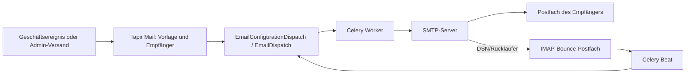

# E-Mail-Verwaltung

Diese Anleitung beschreibt, welche E-Mails Tapir versendet, wie die drei getrennten
Versandwege konfiguriert werden und wo Administratoren Vorlagen, Versandaufträge und Fehler
verwalten.

> **Kurzfassung:** Für die regulären Tapir-Mails genügt ein SMTP-Postfach. Für die im System
> eingebaute Bounce-Erkennung wird zusätzlich ein per IMAP erreichbares Rückläufer-Postfach
> benötigt. Login-, Passwort- und Aktivierungsmails kommen hingegen von **Keycloak** und müssen
> dort separat per SMTP eingerichtet werden. Ein IMAP-Postfach ist kein allgemeiner Eingangskanal
> für Mitgliedsanfragen.

---

## Inhalt

1. [Systemüberblick](#1-systemüberblick)
2. [Mailarten](#2-mailarten)
3. [Was ist eine transaktionale E-Mail?](#3-was-ist-eine-transaktionale-e-mail)
4. [Benötigte Dienste](#4-benötigte-dienste)
5. [Django-/Tapir-Mail konfigurieren](#5-django-tapir-mail-konfigurieren)
6. [Keycloak-Mails konfigurieren](#6-keycloak-mails-konfigurieren)
7. [Optionale Mailinglisten mit Mailman](#7-optionale-mailinglisten-mit-mailman)
8. [Vorlagen, Massenmails und Versandstatus im Frontend](#8-vorlagen-massenmails-und-versandstatus-im-frontend)
9. [`send_verify_emails`: Kontoaktivierung nach einem Import](#9-send_verify_emails-kontoaktivierung-nach-einem-import)
10. [Betrieb, Kontrolle und Fehlersuche](#10-betrieb-kontrolle-und-fehlersuche)

---

## 1. Systemüberblick

Tapir verwendet für E-Mails drei unabhängige Systeme:

| System | Zuständig für | Versandweg | Verwaltung |
|---|---|---|---|
| **Tapir Mail** (`tapir_mail`) | Transaktionale Fachmails und segmentierte Massenmails | Django über SMTP | Tapir unter `/mailing/` |
| **Keycloak** | Kontoaktivierung, Passwort-Reset und sicherheitsrelevante Kontomails | Keycloak über dessen eigenes SMTP | Keycloak-Admin-Konsole |
| **Mailman** (optional) | Diskussions- und Verteilerlisten | eigenständiger Mailman-Server | Tapir + Mailman-Weboberfläche |

Der Versand für Tapir Mail wird asynchron verarbeitet:



Die benötigten Background-Prozesse sind die Docker-Services `celery` und `celery-beat` sowie
Redis. Ohne Worker werden Versandaufträge nicht abgearbeitet; ohne Beat werden Empfänger nicht
aufgelöst, Mail-Batches nicht versendet und Rückläufer nicht geprüft.

Die zentralen Einstellungen stehen in
[tapir/settings/deployment.py](../tapir/settings/deployment.py). Die Mailfunktionen selbst
kommen aus der externen Python-Abhängigkeit `tapir-mail` (siehe
[pyproject.toml](../pyproject.toml)); deren Bedienoberfläche wird in Tapir eingebettet.

---

## 2. Mailarten

### 2.1 Transaktionale Fachmails (Tapir Mail)

Eine transaktionale E-Mail ist die automatische Reaktion auf ein konkretes Ereignis eines
Mitglieds oder eines administrativen Vorgangs. Sie geht an einzelne betroffene Personen und ist
kein Newsletter. Beispiele: Bestellbestätigung, Vertragskündigung oder Bestätigung einer
E-Mail-Änderung.

Diese Vorlagen sind in
[tapir/wirgarten/tapirmail.py](../tapir/wirgarten/tapirmail.py) als Trigger registriert. Die
ursprünglichen MJML-Entwürfe liegen unter
[tapir/wirgarten/email_drafts](../tapir/wirgarten/email_drafts). Beim Start werden sie für
notwendige Trigger als Standardinhalt hinterlegt; anschließend werden sie über die
Mailverwaltung in der Datenbank gepflegt.

| Bereich | Auslöser / Mailart |
|---|---|
| Bestellung und Mitgliedschaft | Anmeldung mit Ernteanteilen, reine Geno-/Vereinsmitgliedschaft, Bestätigung einer administrativ bestätigten Bestellung, widerrufene Bestellung |
| Verträge | Vertragsänderung im Mitgliederbereich, Kündigung in der Probezeit, nicht verlängerter Vertrag, gekündigter Vertrag, Vertrags-/Lieferende |
| Mitgliedsdaten | Änderung des Abholorts, Änderung der E-Mail-Adresse (Bestätigung an alte Adresse, Hinweis an neue Adresse, Erfolgsmeldung), Bestätigung zusätzlicher E-Mail-Adressen |
| Warteliste | Bestätigung des Wartelisteneintrags, verfügbarer Bestelllink, bestätigte Bestellung über Warteliste |
| Genossenschaft/Verein | Beitritt, Kauf bestehender Geschäftsanteile, Kündigung von Geschäftsanteilen, Ende bzw. gesetztes Ende einer Vereinsmitgliedschaft |
| Lieferungen | verwendeter bzw. stornierter Joker und verwendete bzw. stornierte Spende |
| Onboarding | Ereignisbasierter Onboarding-Trigger |

Die E-Mail enthält Platzhalter, die beim Versand durch Daten des Mitglieds, Vertrags,
Abholorts und Standorts ersetzt werden. Beispiele sind `Vorname`, `Abholort`,
`Mitglieds-Nr`, `Vertragsliste`, `Admin Email` oder `Verteilstation - Abholzeiten`.
Unbekannte Platzhalter führen standardmäßig zum Versandfehler, weil
`EMAIL_TOKENS_STRICT_VALIDATION=True` gesetzt ist.

### 2.2 Segmentierte Massenmails (Tapir Mail)

Mit der Mailverwaltung können Administratoren E-Mails an definierte Empfängersegmente senden.
Vordefinierte Segmente umfassen unter anderem alle Benutzer, Geno-Mitglieder, Nicht-
Geno-Mitglieder, Mitglieder mit bzw. ohne laufenden Erntevertrag und die Warteliste.

Massenmails werden in einzelne Versandaufträge aufgeteilt. `celery-beat` stößt jede Minute die
Empfängerauflösung und den Versand an; die Batch-Größe ist in diesem Projekt auf `200` Mails pro
Minute (`EMAIL_DISPATCH_BATCH_SIZE`) gesetzt, theoretisch also höchstens 12.000 pro Stunde.

### 2.3 Keycloak-Identitätsmails

Keycloak verschickt die folgenden Mails selbst. Sie laufen **nicht** über Django/Tapir Mail:

- Aktivierung bzw. Verifikation einer E-Mail-Adresse
- Passwort zurücksetzen
- Bestätigung einer E-Mail-Änderung
- Sicherheits-/Ereignismeldungen, etwa fehlgeschlagener Login oder Änderung von Passwort bzw. MFA

Das Realm-Importprofil aktiviert die E-Mail-Verifikation und Passwort-Resets (`verifyEmail` und
`resetPasswordAllowed`). Angepasste Keycloak-HTML-Vorlagen liegen in
[docker/keycloak/themes/wirgarten/email/html](../docker/keycloak/themes/wirgarten/email/html),
darunter `executeActions.ftl`, `password-reset.ftl`, `email-verification.ftl` und
`email-update-confirmation.ftl`.

### 2.4 Betriebs- und Exportmails

Einige Prozesse versenden Dateien oder betriebliche Informationen direkt mit Django:

- generierte CSV-/PDF-Exporte an konfigurierte Empfänger
- Zahlungsdateien bzw. Fehlermeldungen beim Zahlungs-Export
- automatisch versendete Kommissionier- und Lieferantenlisten, falls die entsprechenden
  Parameter aktiviert sind
- Django-Fehlermails über `SERVER_EMAIL`

Der gemeinsame einfache Versandhelfer
[tapir/wirgarten/service/email.py](../tapir/wirgarten/service/email.py) nutzt
`EmailMultiAlternatives`, kann Anhänge versenden und schreibt einen `EmailLogEntry` als Auditlog.

---

## 3. Was ist eine transaktionale E-Mail?

Transaktionale Mails werden durch einen Geschäftsprozess ausgelöst; sie haben einen fachlichen
Grund und richten sich an die betreffende Person. Sie unterscheiden sich damit von einer
redaktionellen Information bzw. einem Newsletter an viele Empfänger.

Im Code feuert ein Fachprozess einen `TransactionalTrigger` mit Ereignis, Empfänger und
Ereignisdaten. Beispielsweise löst eine Vertragsänderung das Ereignis
`MEMBERAREA_CHANGE_CONTRACT` aus. Tapir Mail sucht die aktive Konfiguration für diesen Trigger,
ersetzt die zulässigen Platzhalter, legt Versandaufträge an und der Celery-Worker liefert sie per
SMTP aus.

Im **Frontend** werden transaktionale Mails nicht durch eine React-Komponente einzeln versendet.
Stattdessen gibt es unter `/mailing/` eine eingebettete Verwaltungsoberfläche von `tapir_mail`.
Die Django-Ansicht [tapir/wirgarten/views/mailing.py](../tapir/wirgarten/views/mailing.py)
erfordert die Berechtigung `Permission.Email.MANAGE` und lädt die eigenständige Mail-Oberfläche
als iFrame. Dort werden Mailkonfigurationen, Trigger, Segmente, Inhalt und Versandaufträge
verwaltet. Der zugehörige React-Code gehört zum installierten Paket `tapir_mail`, nicht zu
`src_frontend/` dieses Repositories.

Mitglieder lösen Mails durch normale Frontend-Workflows aus, etwa Bestellung, Vertragsänderung
oder Änderung der persönlichen Daten. Das Frontend ruft dafür die Fach-APIs auf; der Backend-
Prozess entscheidet anschließend, welcher transaktionale Trigger ausgelöst wird.

---

## 4. Benötigte Dienste

### Minimal: SMTP für die Tapir-Fachmails

Ein normales SMTP-Postfach bzw. SMTP-Relay ist ausreichend, solange der Server aus dem
`web`-/`celery`-Container erreichbar ist und SMTP-Authentifizierung sowie TLS oder SSL unterstützt.
Typische Ports sind 587 mit STARTTLS oder 465 mit SSL. `EMAIL_USE_TLS` und `EMAIL_USE_SSL` sind
gegenseitig ausschließend.

### Empfohlen: separates Bounce-Postfach per IMAP

Für den produktiven Backend-Modus `SmtpBackendWithDsn` fordert Tapir eine
`EMAIL_BOUNCE_ADDRESS` an. Der SMTP-Server soll Zustellstatusberichte/Rückläufer (DSN) dorthin
senden. Celery Beat prüft dieses Konto regelmäßig per IMAP und ordnet Rückläufer einzelnen
Versandaufträgen zu.

Dafür werden IMAP-Zugangsdaten benötigt. Das Postfach kann beim selben Anbieter liegen wie das
SMTP-Postfach; es darf aber auch ein separates Postfach sein. Ohne erreichbares Bounce-Postfach
ist gewöhnlicher SMTP-Versand grundsätzlich möglich, die automatische Rückläufererkennung jedoch
nicht zuverlässig nutzbar.

### Keycloak benötigt zusätzlich SMTP

Keycloak hat eine vollständig eigene SMTP-Konfiguration im Realm. Es kann dieselbe SMTP-
Infrastruktur und gegebenenfalls sogar dasselbe Absenderpostfach verwenden, übernimmt die Django-
Umgebungsvariablen aber **nicht**. Beide Systeme separat testen.

### Nicht benötigt: allgemeiner IMAP-Empfang

Tapir implementiert keinen allgemeinen Eingangskanal, der Mitgliedsnachrichten aus einem
Postfach liest oder Tickets daraus erzeugt. IMAP dient hier nur der Auswertung von Bounce-/DSN-
Nachrichten. Antworten auf `Reply-To` müssen daher in einem normalen betreuten Mailpostfach
bearbeitet werden.

### Zustellbarkeit

Für einen produktiven Absender gehören SPF, DKIM und DMARC zur SMTP-Domain-Konfiguration beim
Mailanbieter. Diese DNS-Einträge werden nicht von Tapir erzeugt. Ein dediziertes Absenderkonto
und eine überprüfte Absenderdomain sind empfehlenswert.

---

## 5. Django-/Tapir-Mail konfigurieren

Die Umgebungsvariablen werden aus `.env.local` gelesen. Produktionswerte gehören in die sichere
Deployment-Konfiguration, nicht in das Git-Repository.

```dotenv
# Tapir Mail: Produktionsmodus
EMAIL_ENV=prod
EMAIL_HOST=smtp.example.org
EMAIL_PORT=587
EMAIL_USE_TLS=True
EMAIL_USE_SSL=False
EMAIL_HOST_USER=tapir@example.org
EMAIL_HOST_PASSWORD=<SMTP-Passwort>

# Sichtbarer Absender
EMAIL_HOST_SENDER=mitglieder@example.org
EMAIL_HOST_SENDER_NAME="Meine Solawi"

# Rückläufer/DSN; für Bounce-Auswertung per IMAP
EMAIL_BOUNCE_ADDRESS=bounces@example.org
EMAIL_BOUNCE_USER=bounces@example.org
EMAIL_BOUNCE_PASSWORD=<IMAP-Passwort>
# nur setzen, falls IMAP nicht auf EMAIL_HOST liegt
EMAIL_BOUNCE_HOST=imap.example.org
EMAIL_PORT_IMAP=993

# optional
EMAIL_REPLY_TO=kontakt@example.org
EMAIL_AUTO_BCC=archiv@example.org

# Absender von Django-Fehlermails
SERVER_EMAIL=tapir@example.org
```

| Variable | Bedeutung |
|---|---|
| `EMAIL_ENV` | `dev`, `test` oder `prod`. Nur `prod` verwendet den DSN-fähigen Tapir-Mail-SMTP-Backend. |
| `EMAIL_HOST`, `EMAIL_PORT` | SMTP-Host und Port. Port-Vorgabe: 587. |
| `EMAIL_USE_TLS`, `EMAIL_USE_SSL` | Transportverschlüsselung; nur eine der beiden Optionen aktivieren. |
| `EMAIL_HOST_USER`, `EMAIL_HOST_PASSWORD` | SMTP-Zugangsdaten. |
| `EMAIL_HOST_SENDER`, `EMAIL_HOST_SENDER_NAME` | sichtbare Absenderadresse und Anzeigename für Tapir-Mails. |
| `EMAIL_BOUNCE_ADDRESS` | Return-Path-/DSN-Zieladresse. Im Produktivmodus erforderlich. |
| `EMAIL_BOUNCE_USER`, `EMAIL_BOUNCE_PASSWORD`, `EMAIL_BOUNCE_HOST`, `EMAIL_PORT_IMAP` | IMAP-Zugang zum Bounce-Postfach. `EMAIL_BOUNCE_HOST` ist optional und fällt auf `EMAIL_HOST` zurück. |
| `EMAIL_REPLY_TO` | optionale Adresse für Antworten von Mitgliedern. |
| `EMAIL_AUTO_BCC` | optionale globale BCC-Adresse für den einfachen Django-Mailhelfer. Nicht als Ersatz für ein Datenschutz- oder Archivierungskonzept verwenden. |
| `SERVER_EMAIL` | Absender von Django-Fehlermeldungen. |

### Umgebungsmodi

| `EMAIL_ENV` | Verhalten |
|---|---|
| `dev` (Vorgabe) | Mails werden nicht versendet, sondern als Dateien in `emails_from_celery/` geschrieben. |
| `test` | Django-SMTP-Backend; SMTP-Host und Zugangsdaten kommen aus der Umgebung bzw. den Django-Standards. |
| `prod` | `tapir_mail.service.smtp_backend_with_dsn.SmtpBackendWithDsn`; SMTP plus DSN-/Bounce-Verarbeitung. |

### Inbetriebnahme

1. `EMAIL_ENV=prod` und alle SMTP-Werte setzen.
2. Separate Bounce-Adresse und deren IMAP-Zugang einrichten.
3. `EMAIL_BOUNCE_ADDRESS` als Return-Path beim SMTP-Anbieter erlauben.
4. `EMAIL_REPLY_TO` auf ein betreutes Postfach setzen.
5. Die Services `web`, `celery`, `celery-beat` und `redis` starten.
6. In Keycloak den getrennten SMTP-Test durchführen.
7. Zuerst eine Testvorlage an einen internen Empfänger senden und Versandstatus bzw. Bounce-Log
   kontrollieren.

---

## 6. Keycloak-Mails konfigurieren

Keycloak versendet die Identitätsmails selbst. Die Konfiguration erfolgt in der Keycloak-
Admin-Konsole für das Realm `tapir`, üblicherweise unter **Realm settings → Email**. Dort SMTP-
Host, Port, From, From display name, Reply-To, Verschlüsselung und Zugangsdaten setzen und die
Funktion **Test connection** bzw. **Test email** verwenden.

Für die Tapir-Verbindung und die Aktivierungsmails sind zusätzlich diese Django-Variablen relevant:

```dotenv
KEYCLOAK_ADMIN_SERVER_URL=http://keycloak:8080
KEYCLOAK_PUBLIC_URL=https://login.example.org
KEYCLOAK_CLIENT_ID=tapir-backend
KEYCLOAK_FRONTEND_CLIENT_ID=tapir-frontend
KEYCLOAK_REALM_NAME=tapir
KEYCLOAK_ADMIN_CLIENT_SECRET_KEY=<Client-Secret>
KEYCLOAK_SKIP_VERIFICATION_EMAIL=False
SITE_URL=https://tapir.example.org
```

| Einstellung | Wirkung |
|---|---|
| `KEYCLOAK_SKIP_VERIFICATION_EMAIL` | `True` unterdrückt nur den Versand der Keycloak-Aktivierungsmail aus Tapir. In `docker-compose.yml` ist dies lokal absichtlich auf `True` gesetzt. Für Produktivbetrieb muss der Wert `False` sein. |
| `SITE_URL` | Ziel nach erfolgreicher Keycloak-Aktion. |
| `KEYCLOAK_PUBLIC_URL` | öffentliche URL, die Browser für Keycloak erreichen. |
| SMTP im Keycloak-Realm | tatsächlicher Versandweg für Aktivierungs-, Reset- und Kontomails. |

Die Keycloak-Vorlagen werden mit FreeMarker (`.ftl`) gerendert. Für die von Tapir ausgelöste
Aktivierung verwendet der Dienst bewusst `executeActions.ftl`: Der Code ruft nicht
`send_verify_email`, sondern `send_update_account(..., ["VERIFY_EMAIL"])` auf. Dadurch bleibt
der angepasste Text aus der WirGarten-Keycloak-Theme über Keycloak-Versionen hinweg erhalten.
Siehe [tapir/accounts/services/email_verification_service.py](../tapir/accounts/services/email_verification_service.py).

> Änderungen am Realm über die Keycloak-Oberfläche sind nicht automatisch in
> `docker/keycloak/import/tapir-realm.json` gespeichert. Für reproduzierbare Deployments die
> SMTP- und Theme-Änderungen nachvollziehbar außerhalb des Repositories dokumentieren bzw. als
> kontrollierten Realm-Export verwalten; Passwörter niemals in den Realm-Export einchecken.

---

## 7. Optionale Mailinglisten mit Mailman

Mailman ist ein separates System für **echte Mailinglisten**. Eine Mailingliste hat eine eigene
Listenadresse, verwaltet Abonnenten und verteilt eine an diese Adresse gesendete Nachricht an
alle Listenmitglieder. Tapir kann solche Listen und deren Empfänger verwalten; die Verarbeitung
der ein- und ausgehenden Listennachrichten übernimmt Mailman.

### Wann wird Mailman benötigt?

Mailman ist sinnvoll, wenn Mitglieder oder Arbeitsgruppen miteinander über eine gemeinsame
Adresse kommunizieren sollen. Beispiele:

- `abholort-nord@solawi.example.org`: Informationen und Rückfragen für alle Mitglieder eines
  Abholorts
- `helfer@solawi.example.org`: Austausch einer Arbeitsgruppe, bei dem alle Antworten wieder an
  die Gruppe gehen sollen
- `verein@solawi.example.org`: Verteiler für Vereinsmitglieder, dessen Abonnenten sich selbst
  an- oder abmelden können

Die Listenadresse ist dabei nicht bloß ein gespeicherter Verteiler. Mailman führt den
Mitgliederbestand, verarbeitet An- und Abmeldungen, kann Bestätigungen verlangen und nimmt
Nachrichten an die Listenadresse entgegen. Je nach Mailman-Konfiguration moderiert oder
archiviert es Nachrichten und verteilt sie anschließend an die Abonnenten.

### Abgrenzung zu den normalen Mailmöglichkeiten in Tapir

| Funktion | Tapir Mail | Mailman |
|---|---|---|
| Hauptzweck | Systemmails und gezielte Rundmails | Kommunikation über gemeinsame Listenadressen |
| Typischer Auslöser | Bestellung, Vertragsänderung, Admin-Dispatch | E-Mail an eine Listenadresse oder Listenverwaltung |
| Empfänger | einzelne Betroffene oder in Tapir definierte Segmente | Abonnenten einer Mailman-Liste |
| Antworten von Mitgliedern | gehen an `Reply-To` bzw. ein betreutes Postfach | können wieder über die Listenadresse an alle Teilnehmer verteilt werden |
| Empfang eingehender Mails | Tapir verarbeitet keine allgemeinen eingehenden Mails | Mailman verarbeitet Mails an Listenadressen |
| Vorlagen / Platzhalter | Tapir Mail, Trigger und Platzhalter | Mailman-Listenregeln und eigene Mailman-Vorlagen |
| Benötigte Infrastruktur | SMTP; optional IMAP für Bounces | eigener Mailman-Dienst zusätzlich zu einem ein- und ausgehenden Mailtransport |

**Beispiel 1: Bestellbestätigung.** Ein Mitglied schließt eine Bestellung ab. Tapir löst den
Trigger „BestellWizard: Mitgliedschaft + Ernteanteile“ aus und verschickt genau eine
personalisierte Bestätigung. Mailman ist dafür nicht beteiligt.

**Beispiel 2: Frage zur Abholung.** Ein Mitglied schreibt an
`abholort-nord@solawi.example.org`. Mailman nimmt diese Nachricht an und verteilt sie nach den
Listenregeln an alle Abonnenten der Gruppe. Tapir Mail und die Transaktionsvorlagen sind dabei
nicht beteiligt.

**Beispiel 3: Admin-Information an alle Mitglieder.** Eine einmalige Info kann als segmentierte
Massenmail aus Tapir Mail verschickt werden. Soll daraus ein dauerhafter Diskussionsverteiler
werden, auf dem Mitglieder antworten und sich an- bzw. abmelden können, ist eine Mailman-Liste
das passendere Werkzeug.

### Aktivierung und Verwaltung

Die Integration ist standardmäßig deaktiviert und wird mit `MAILING_LISTS_ENABLED=True`
eingeschaltet. Sie benötigt einen erreichbaren Mailman-3-Server und dessen REST-API-Zugang:

```dotenv
MAILING_LISTS_ENABLED=True
MAILMAN_URL=https://mailman.example.org/3.1/
MAILMAN_ADMIN_USER=<Mailman-API-Benutzer>
MAILMAN_ADMIN_PASSWORD=<Mailman-API-Passwort>
```

Die in [tapir/settings/base.py](../tapir/settings/base.py) vorgesehenen Vorgabewerte sind nur
für lokale Entwicklung bestimmt. Zugangsdaten gehören in die sichere Deployment-Konfiguration.

Nach Aktivierung ist die Listenverwaltung in Tapir unter `/core/mailing_lists` verfügbar und
erfordert `Permission.Coop.MANAGE`. Dort können Administratoren Listen erstellen, ändern oder
löschen sowie interne Mitglieder und externe Adressen abonnieren bzw. abmelden. Mitglieder
können die für sie freigegebenen Listen über die bereitgestellten Selbstbedienungs-APIs anfragen
und bestätigen.

Mailman benötigt einen eigenen Server bzw. Dienst und ist **keine** Voraussetzung dafür, dass
Tapir Transaktions- oder Massenmails verschickt. Ein normales SMTP-/IMAP-Postfach ersetzt
Mailman nicht, wenn echte Diskussionslisten mit Abonnements und eingehenden Nachrichten gewünscht
sind. Die Details und eine lokale Docker-Compose-Referenz mit Mailpit stehen in
[README.md](../README.md) im Abschnitt „Mailing lists“.

---

## 8. Vorlagen, Massenmails und Versandstatus im Frontend

### Zugang

Die Mailverwaltung ist unter `/mailing/` eingebunden. Sie erfordert die Berechtigung
`Permission.Email.MANAGE`. Der Django-Wrapper
[tapir/wirgarten/templates/wirgarten/email/tapir_mail_iframe.html](../tapir/wirgarten/templates/wirgarten/email/tapir_mail_iframe.html)
lädt die Oberfläche unter dem internen Pfad `/tapirmail/` als iFrame.

### Aufgaben in der Mailverwaltung

Dort werden die vom Paket `tapir_mail` bereitgestellten Objekte verwaltet:

| Objekt | Zweck |
|---|---|
| E-Mail-Konfiguration | Betreff, Inhalt, Trigger, Empfängerlogik und Version einer transaktionalen oder segmentierten Mail |
| Segment | Empfängergruppe für Massenmails |
| E-Mail-Konfigurations-Dispatch | geplanter Versand einer Konfiguration |
| E-Mail-Dispatch | einzelner Versandauftrag mit Status, Empfänger und Fehler-/Bounce-Information |

Beim Bearbeiten von Vorlagen nur die in der Oberfläche angebotenen Platzhalter verwenden.
Aufgrund der strikten Platzhalterprüfung verhindert ein unbekannter Platzhalter den Versand. Nach
Änderungen zunächst an einen internen Testempfänger senden und den einzelnen E-Mail-Dispatch
prüfen.

### Versandstatus und Audit

- Tapir Mail führt Versandaufträge pro Empfänger. Dort sind mindestens ausstehende, gesendete und
  fehlerhafte Aufträge sowie Rückläufer relevant.
- Der einfache Django-Mailhelfer schreibt zusätzlich `EmailLogEntry`-Einträge. Diese enthalten
  Empfänger, Betreff, Inhalt und zugeordnetes Mitglied, sofern die erste Empfängeradresse einem
  Mitglied entspricht.
- Die Aktivierungsmail aus Keycloak erzeugt in Tapir einen `TextLogEntry` mit
  „Keycloak Email gesendet: Aktivierung des Benutzerkontos“. Das bestätigt den Keycloak-API-Aufruf,
  nicht zwingend die Zustellung beim Empfänger.

---

## 9. `send_verify_emails`: Kontoaktivierung nach einem Import

Das Kommando
[tapir/wirgarten/management/commands/send_verify_emails.py](../tapir/wirgarten/management/commands/send_verify_emails.py)
ist für importierte Mitglieder gedacht, die noch keinen Keycloak-Account haben:

```bash
# Liste prüfen; nach der interaktiven Bestätigung wird im Dry-Run nichts verändert
docker compose exec web poetry run python manage.py send_verify_emails --dry-run

# Nur Mitglieder mit aktuellem oder zukünftigem Vertrag
docker compose exec web poetry run python manage.py send_verify_emails \
  --only-members-with-subscription

# Nur Mitglieder ohne aktuellen/zukünftigen Vertrag
docker compose exec web poetry run python manage.py send_verify_emails \
  --only-members-without-subscription

# Tatsächlicher Versand
docker compose exec web poetry run python manage.py send_verify_emails
```

### Auswahl und Ablauf

1. Das Kommando wählt `Member` ohne `keycloak_id`.
2. Berücksichtigt werden nur Mitglieder mit positivem Gesamtwert an Geschäftsanteilen **oder**
   mindestens einem aktuellen bzw. zukünftigen Vertrag.
3. Es zeigt alle betroffenen Mitglieder einschließlich ihrer Verträge und verlangt eine
   interaktive Bestätigung mit `y` oder `yes`.
4. Ohne `--dry-run` erstellt `KeycloakUserManager.create_keycloak_user_if_necessary` den
   Keycloak-Account.
5. `EmailVerificationService.send_verification_email` ruft die Keycloak-Admin-API auf.
6. Keycloak versendet die Aktivierungsmail mit seinem Realm-SMTP und der Keycloak-Vorlage
   `executeActions.ftl`.

`--dry-run` beendet sich nach der Bestätigung vor Kontoerzeugung und E-Mail-Versand. Fehler für
Einzelmitglieder werden ausgegeben; das Kommando fährt anschließend mit den übrigen Mitgliedern
fort.

### Voraussetzungen vor dem Echtlauf

- `KEYCLOAK_SKIP_VERIFICATION_EMAIL=False`
- Keycloak-SMTP ist im Realm konfiguriert und mit **Test email** erfolgreich geprüft.
- `KEYCLOAK_PUBLIC_URL` und `SITE_URL` sind öffentlich korrekt erreichbar.
- Die E-Mail-Adressen im Mitgliederdatenbestand sind geprüft; insbesondere keine importierten
  Platzhalteradressen wie `team+missing_mail_...@foodcoopx.de` verwenden.
- Zuerst ein einzelnes Testmitglied bzw. eine eingegrenzte Gruppe aktivieren.

Administratoren können für ein einzelnes Mitglied die Aktivierung außerdem erneut über den
Mitgliederbereich auslösen; die Route ist
`/members/<mitglied-id>/resendverifyemail`.

---

## 10. Betrieb, Kontrolle und Fehlersuche

### Regelmäßige Kontrollen

| Kontrolle | Erwartung / Maßnahme |
|---|---|
| Celery Worker | läuft und verarbeitet Versandaufträge |
| Celery Beat | läuft und löst minütlich Empfängerauflösung, Batch-Versand und Bounce-Prüfung aus |
| Redis | erreichbar; Warteschlange wird abgearbeitet |
| Mailverwaltung | keine dauerhaft fehlerhaften oder wartenden E-Mail-Dispatches |
| Bounce-Postfach | per IMAP erreichbar; Rückläufer werden verarbeitet |
| Keycloak | SMTP-Test erfolgreich; Aktivierungs- und Resetmails kommen an |
| DNS | SPF, DKIM und DMARC für die Absenderdomain aktiv |

### Häufige Ursachen

| Symptom | Wahrscheinliche Ursache / Prüfung |
|---|---|
| Keine Tapir-Mails gehen raus | `EMAIL_ENV` ist noch `dev`; oder `celery`/`celery-beat`/Redis laufen nicht; SMTP-Zugangsdaten und Container-Netzwerk prüfen. |
| Mail steht im Dispatch auf Fehler | Fehlermeldung im einzelnen Dispatch prüfen; häufig SMTP-Authentifizierung, unbekannter Platzhalter oder nicht erreichbarer SMTP-Host. |
| Aktivierungs-Mail kommt nicht | `KEYCLOAK_SKIP_VERIFICATION_EMAIL` prüfen; Keycloak-Realm-SMTP und nicht die Django-SMTP-Werte testen. |
| Aktivierungslink führt falsch zurück | `KEYCLOAK_PUBLIC_URL` und `SITE_URL` auf öffentliche HTTPS-URLs prüfen. |
| Keine Bounce-Informationen | IMAP-Credentials, `EMAIL_BOUNCE_ADDRESS`, `EMAIL_BOUNCE_HOST` und DSN-Unterstützung des SMTP-Anbieters prüfen. |
| Antworten erreichen niemanden | `EMAIL_REPLY_TO` auf ein betreutes Postfach setzen. Ohne diese Angabe hängt das Antwortverhalten vom Absender ab. |
| Lokaler Versand landet nicht im Postfach | Normal bei `EMAIL_ENV=dev`: Mails werden als Dateien in `emails_from_celery/` gespeichert. |

### Sichere Änderungen an Mailvorlagen

1. Vorlage in `/mailing/` öffnen und fachlichen Auslöser sowie Empfänger prüfen.
2. Inhalt ändern; nur bekannte Platzhalter verwenden.
3. Test-Dispatch an eine interne Adresse auslösen.
4. Darstellung, Links, Platzhalterwerte und Reply-To im zugestellten Mailclient prüfen.
5. Erst danach die Vorlage bzw. Versandkonfiguration für Mitglieder aktivieren.

Keine Zugangsdaten, SMTP-Passwörter, Client-Secrets oder Bounce-Passwörter in Vorlagen, Logs,
Datenexporte oder das Git-Repository aufnehmen.
