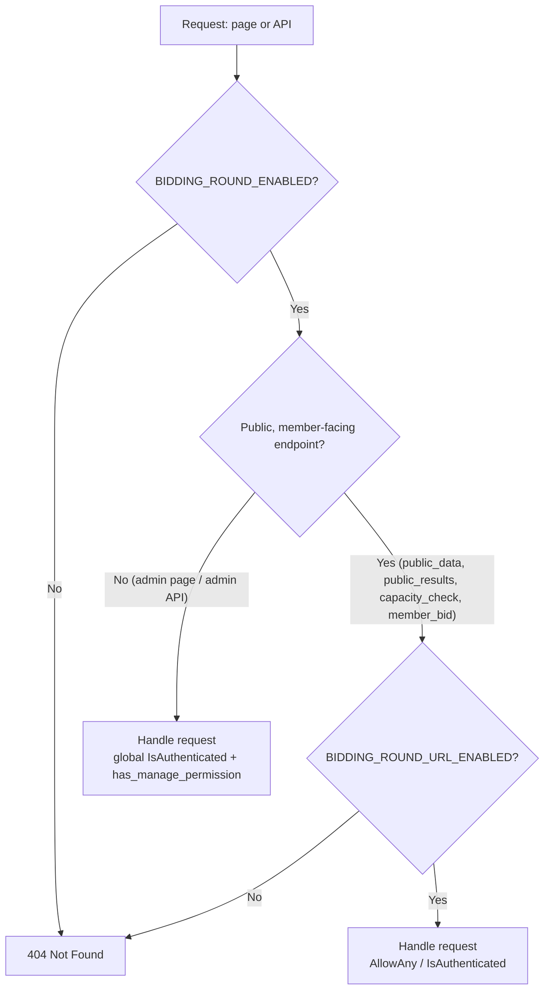
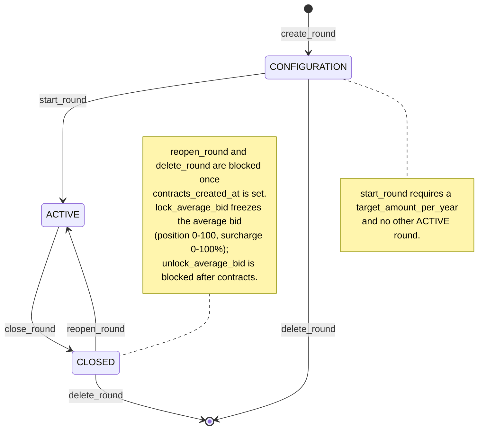
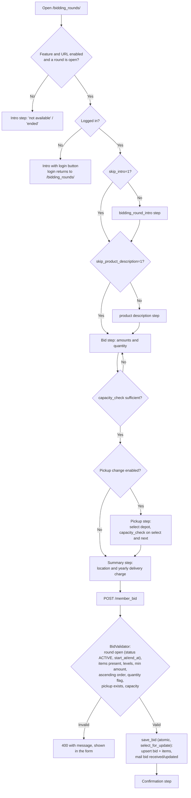
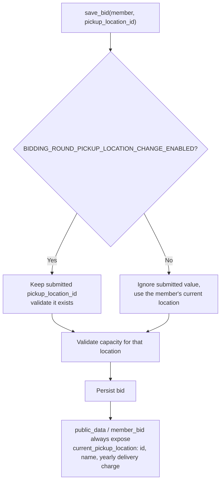
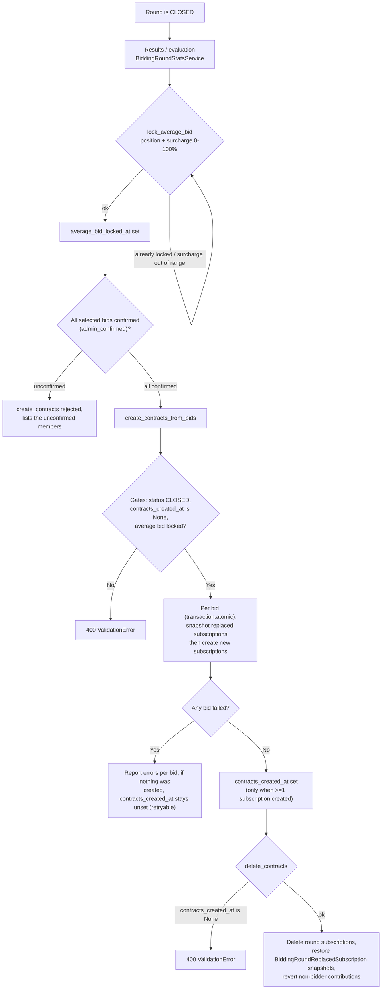

# Bidding round (Beitragsrunde)

The bidding round lets members submit a bid (monthly contribution) for harvest shares. After the
round ends, the operator locks an average bid and creates the matching subscriptions.

## Feature flags

Two parameters gate the feature (see `tapir/wirgarten/parameter_definitions/parameter_definitions_bidding_round.py`):

- `BIDDING_ROUND_ENABLED` – master switch. When off, **every** bidding-round page and API endpoint
  answers with `404` (enforced by `BiddingRoundFeatureFlagMixin` / `BiddingRoundFeaturePermission` in
  `tapir/bidding_round/permissions.py`).
- `BIDDING_ROUND_URL_ENABLED` – additionally gates the public, member-facing endpoints
  (`public_data`, `public_results`, `public_bids/capacity_check`, `member_bid`). Admin endpoints stay
  reachable so an operator can still configure the round.

## Lifecycle

`BiddingRoundService` (see `tapir/bidding_round/services/bidding_round_service.py`) owns the status
transitions:

`CONFIGURATION` → `ACTIVE` (`start_round`, one active round at a time) → `CLOSED` (`close_round`).
`reopen_round` and `delete_round` are blocked once `contracts_created_at` is set.

## Bidding

- Members both bid through `MemberBidView`; operators can enter/edit bids through the admin endpoints.
- `BidValidator` (`tapir/bidding_round/services/bid_validator.py`) validates round openness, product/round
  consistency, levels, the minimum amount and the quantity flag. Amounts are parsed defensively.
- `save_bid` / `save_admin_bid` run inside a transaction and lock the round row.
- `BIDDING_ROUND_BID_QUANTITY_ENABLED` is enforced server-side: when off, only `quantity == 1` is accepted.
- Pickup locations: when `BIDDING_ROUND_PICKUP_LOCATION_CHANGE_ENABLED` is off, a submitted location is
  ignored and the member's own location is kept. The member's own location is always exposed through
  `current_pickup_location` (incl. yearly delivery charge), independently of that flag.
- Bids can no longer be changed once contracts have been created.

## Evaluation and contracts

- `BiddingRoundStatsService` builds the results, statistics, traffic-light position and financing
  projection.
- `BiddingRoundService.lock_average_bid` freezes the average bid (position, surcharge).
- `ContractCreator.create_contracts_from_bids` creates the subscriptions. It only sets
  `contracts_created_at` when at least one subscription was created, so a failed run can be retried.
  Existing non-cancelled subscriptions for the same product/season are replaced; the originals are
  snapshotted in `BiddingRoundReplacedSubscription` and restored by
  `BiddingRoundContractDeletionService.delete_contracts`.

## Flow diagrams

### 1. Feature-flag gating (pages and API)

Every bidding-round page and API endpoint passes the same gate. `BiddingRoundFeatureFlagMixin` /
`BiddingRoundFeaturePermission` run before the view logic; the public endpoints additionally require
`BIDDING_ROUND_URL_ENABLED`.

### 2. Round lifecycle and status gates

### 3. Member bidding flow (frontend steps, checks and backend gates)

### 4. Pickup-location decision

### 5. Evaluation, average-bid lock and contract creation/deletion

### Checks and gates summary

| Gate | Rule | Where |
|---|---|---|
| Master flag | `BIDDING_ROUND_ENABLED=false` -> 404 everywhere | `permissions.py` |
| Public URL flag | `BIDDING_ROUND_URL_ENABLED=false` -> 404 for public/member endpoints only | `permissions.py` |
| Round start | needs `target_amount_per_year`, no other ACTIVE round | `BiddingRoundService.start_round` |
| Round reopen/delete | blocked once `contracts_created_at` is set | `BiddingRoundService.reopen_round` / `delete_round` |
| Member bid | only Members; round `ACTIVE`, `start_at <= now <= end_at`; atomic + row lock | `save_bid`, `BidValidator._validate_round_is_open` |
| Item | shares belong to the round, product to the product type, amounts finite/non-negative/ascending, min amount, quantity 1-5 | `BidValidator._validate_item` / `_validate_levels` / `_parse_amounts` |
| Quantity flag | `BIDDING_ROUND_BID_QUANTITY_ENABLED=false` -> only `quantity == 1` | `BidValidator._is_quantity_enabled` |
| Pickup | when change is off, submitted location is ignored; otherwise must exist | `BiddingRoundService._resolve_pickup_location_id`, `BidValidator._validate_pickup_locations` |
| Capacity | products/quantity/location must fit remaining capacity | `BidValidator._validate_capacity`, `capacity_check` |
| Bid edit after contracts | item changes and pickup changes are blocked | `save_admin_bid` |
| Lock average bid | not already locked; surcharge 0-100% | `BiddingRoundService.lock_average_bid` |
| Unlock average bid | blocked once `contracts_created_at` is set | `BiddingRoundService.unlock_average_bid` |
| Create contracts | `CLOSED`, average bid locked, not already created, all selected bids confirmed | `ContractCreator.create_contracts_from_bids` |
| Delete contracts | requires `contracts_created_at` set | `BiddingRoundContractDeletionService.delete_contracts` |

## Tests

`make test-app APP=bidding_round`. The end-to-end demo data comes from
`tapir/utils/services/test_data_generation/bidding_round_generator.py`.
