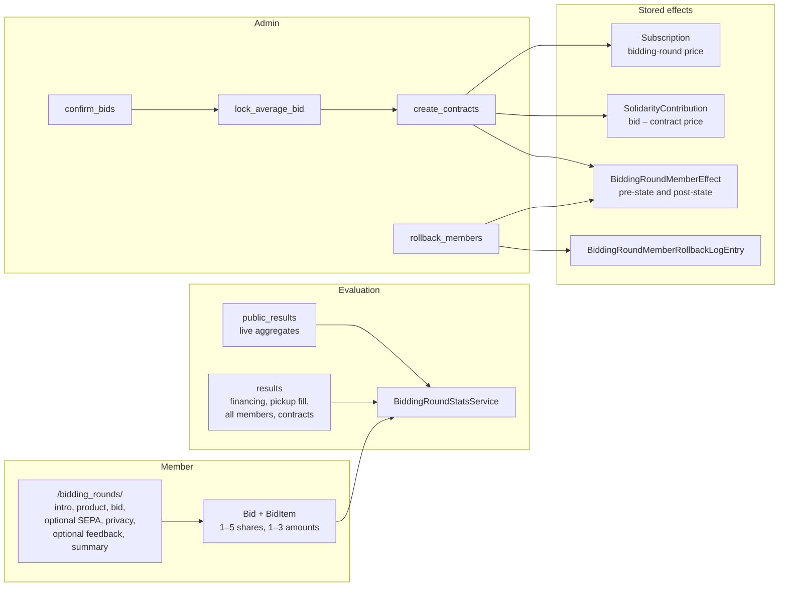
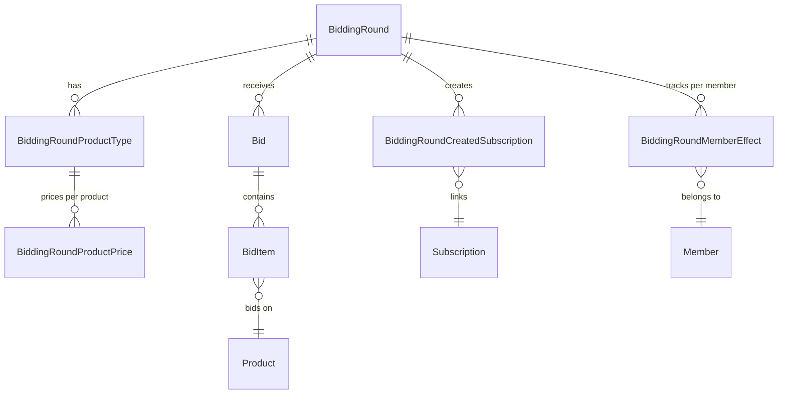
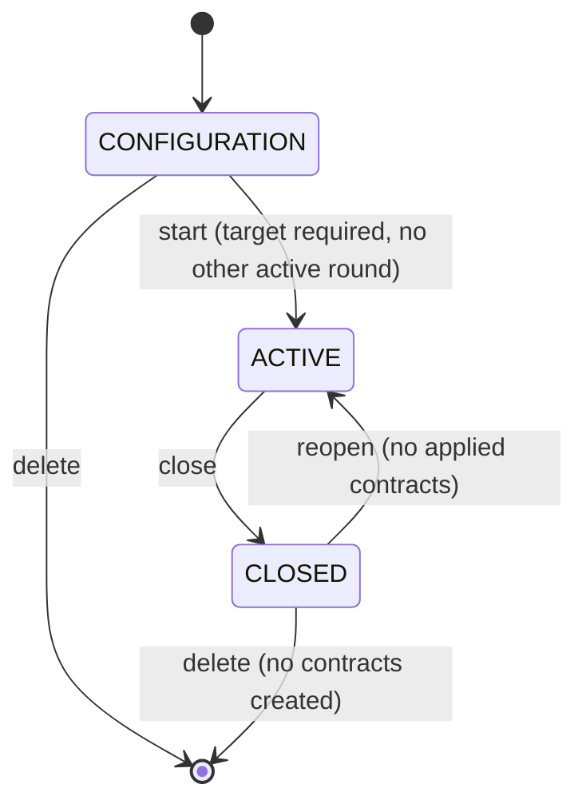
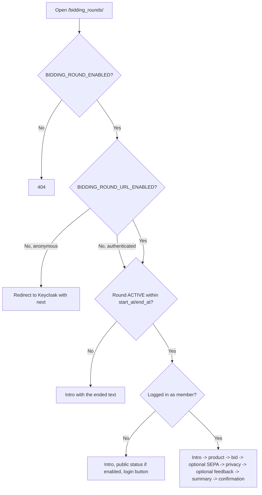
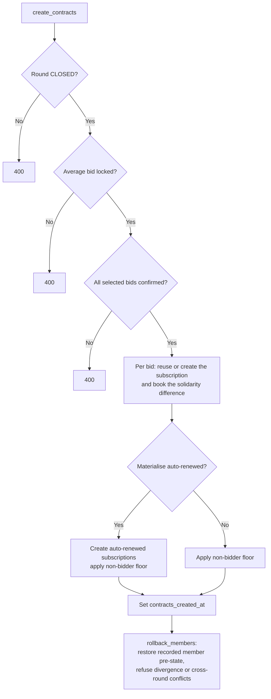

# Bidding round (Beitragsrunde)

The bidding round lets existing members submit a monthly contribution for a harvest share. When the
round ends, the operator confirms the bids, locks an average bid and creates the matching
subscriptions. Everything sits behind `BIDDING_ROUND_ENABLED`: while it is off, the member pages and
the member-facing endpoints answer 404 and no bids can be submitted.

German is the language of everything a member or an administrator sees (templates, parameters,
mails, frontend strings). Code, comments and this document are English, like the rest of the
repository.

## Overview

The feature has four moving parts: the member wizard writes bids, the live evaluation reads them,
the admin tools confirm and lock them, and contract creation turns them into subscriptions and
solidarity contributions. The round is the only place where the season target, the bid levels and
the non-bidder rule meet.



## Where the code lives

| Piece | Path |
|---|---|
| Models, status/procedure constants, share limits | `tapir/bidding_round/models.py`, `tapir/bidding_round/config.py` |
| Round lifecycle and bid persistence | `tapir/bidding_round/services/bidding_round_service.py` |
| Bid validation | `tapir/bidding_round/services/bid_validator.py` |
| Evaluation, financing projection, results table | `tapir/bidding_round/services/bidding_round_stats_service.py` |
| Public data, pickup location and admin serialization | `tapir/bidding_round/services/bidding_round_view_service.py` |
| Contract rows for the evaluation | `tapir/bidding_round/services/bidding_round_contract_row_service.py` |
| Contract creation and member-level rollback | `tapir/bidding_round/services/contract_creator.py`, `tapir/bidding_round/services/round_member_effect_service.py` |
| Non-bidder floor and auto-renewed contracts | `tapir/bidding_round/services/non_bidder_contribution_service.py` |
| Mails and tokens | `tapir/bidding_round/services/bidding_round_mail_token_builder.py`, `tapir/wirgarten/mail_events.py` |
| Pages, API, admin actions | `tapir/bidding_round/views.py`, `urls.py` |
| Member wizard | `src_frontend/bidding_round/**` |
| Admin evaluation | `src_frontend/bidding_round_results/**` |
| Admin configuration | `src_frontend/bidding_round_config/**` |
| Demo data | `tapir/utils/services/test_data_generation/bidding_round_generator.py` |
| Tests | `tapir/bidding_round/tests/**`, `tapir/utils/tests/services/test_data_generation/test_bidding_round_generator.py` |

## Feature flags

| Parameter | Default | Effect |
|---|---|---|
| `BIDDING_ROUND_ENABLED` | off | Master switch. When off, every page and endpoint answers `404` (`BiddingRoundFeatureFlagMixin`). |
| `BIDDING_ROUND_URL_ENABLED` | on | Public page. When off, anonymous visitors are redirected to Keycloak; members keep the page, and the member-facing API requires authentication. Admin pages and endpoints stay reachable. |
| `BIDDING_ROUND_STATUS_ENABLED` | on | Shows the live interim status. When off, the status is hidden and `public_results` answers `404` for everyone. |
| `BIDDING_ROUND_STATUS_PUBLIC_ENABLED` | on | Lets anonymous visitors see the live status. When off, `public_results` requires authentication; members still see the status. |
| `BIDDING_ROUND_SEPA_ENABLED` | on | Adds the optional SEPA step after the bid. When off, the step is skipped. |
| `BIDDING_ROUND_FEEDBACK_ENABLED` | on | Adds the optional feedback step after privacy. When off, the step is skipped. |
| `BIDDING_ROUND_BID_SHARES_ENABLED` | off | Shows the +/− share controls in the bid step. When off, the wizard uses the current subscription's share count, otherwise 1. The API and validation still accept 1–5 shares. The parameter page warns that the bidding round does not check capacities. |
| `BIDDING_ROUND_BID_CAROUSEL_ENABLED` | off | Shows the product carousel. When off, the wizard renders the current or first variant statically. The parameter page carries the same capacity warning. |

| `ENABLED` | `URL_ENABLED` | anonymous page | anonymous member API | member page + API | admin pages + API |
|---|---|---|---|---|---|
| false | any | 404 | 404 | 404 | 404 |
| true | true | reachable | reachable | reachable | reachable |
| true | false | redirect to Keycloak | 404 | reachable | reachable |

`BIDDING_ROUND_STATUS_ENABLED` and `BIDDING_ROUND_STATUS_PUBLIC_ENABLED` only affect the interim
status endpoint and card; they do not gate bidding. `BIDDING_ROUND_SEPA_ENABLED` and
`BIDDING_ROUND_FEEDBACK_ENABLED` only add or remove their step; they do not gate the API or the rest
of the flow. The share and carousel switches only change the controls, not the stored bid; they are
purely presentational, and toggling them does not invalidate existing bids.

The non-bidder floor is not configurable: non-bidders always pay at least the bidder average per
share. Concretely the contract price is `max(reference_value, locked bidder average)`, scaled by the
round product size and quantity. The evaluation page's financing projection is a **what-if** model
with a target-covered average; it does not change contract prices.

Only one round per growing period may create contracts. A second round of the same period is allowed
and can be evaluated, but `ContractCreator` refuses to create contracts while another round of that
period already has `contracts_created_at` set; a partial unique constraint backs the rule.

## Data model



- `BiddingRound`: growing period, name, status (`configuration` / `active` / `closed`),
  `bidding_procedure`, bid levels, start/end, comment, `include_auto_renewed`, `contracts_created_at`
  and the locked average bid values.
- `BiddingRoundProductType`: exactly one biddable product type per round plus
  `target_amount_per_year`.
- `BiddingRoundProductPrice`: `reference_value` and `min_amount` per share plus the round's
  product `size`. The values apply 1:1 per share; `size` scales the contract price and is not
  `ProductPrice.size`.
- `Bid` / `BidItem`: one bid per member and round, one item per product with a share count and the
  procedure's amounts (`amount_1..3`; the bid range uses `amount_1` = green and `amount_2` = red),
  plus the confirmation/admin flags. The bid does not store a pickup location; evaluation, CSV
  export, mails and contract creation read the member's location at the contract start date through
  `MemberPickupLocationGetter`.
- `BiddingRoundCreatedSubscription`: link from the round to the subscriptions created from it;
  `is_bidder_contract` separates bidder contracts from auto-renewed contracts; `was_reused` and
  `original_quantity` preserve a reused existing subscription.
- `BiddingRoundMemberEffect`: per round and member, the serialized pre-state and post-state of
  subscriptions and solidarity contributions, the contribution log links and the mandate references.
- `BiddingRoundMemberRollbackLogEntry`: audit entry for a member rollback.
- `OrderFeedback` (`wirgarten`): member feedback from the optional bidding-round step, created on
  submit when `feedback` is not empty.

The `bidding_round` migrations form a linear chain. `0005` is unused: the summary-title data
migration was dropped while the feature was unreleased, so the defaults live only in the parameter
definitions.

| Migration | Layer | Content |
|---|---|---|
| `0001_initial` | S02 | Round, product type, price, bid, bid item, created subscription |
| `0002_bidding_round_procedure_and_bid_levels` | S03 | Procedure, bid levels, amount levels |
| `0003_biddinground_include_auto_renewed` | S06 | `include_auto_renewed` |
| `0004_bid_admin_confirmed_bid_entered_by_admin_and_more` | S07 | Admin confirmation, manual bids, average-bid lock |
| `0006_biddingroundcreatedsubscription_is_bidder_contract` | S13 | Bidder flag and reuse metadata; depends on `0004` |
| `0007_biddingroundmembereffect` | S15 | Member effect ledger and rollback audit entry |
| `0008_biddinground_contracts_per_growing_period` | S15 | Unique constraint: one round with contracts per growing period |

## Lifecycle

`BiddingRoundService` owns the transitions:

`CONFIGURATION` → `ACTIVE` (`start_round`, at most one active round) → `CLOSED` (`close_round`).
`reopen_round` and `delete_round` are blocked while any member effect is applied, i.e. after
contracts have been created.



Admin order after the round: **confirm bids** → **lock the average bid** → **create contracts**.
CSV export, manual bids and the results table are available before the contracts are created.

## Member journey

**Only logged-in existing members bid during the round.** New members are created before or after the
round through the regular order wizard, never during the round. There is no registration and no
waiting-list path inside the bidding round.

1. Open `/bidding_rounds/` (login first if needed).
2. Intro with the live interim status, skippable with `?skip_intro=1` for logged-in members.
3. Product choice as a carousel with product images and the reference value per share size. With
   `BIDDING_ROUND_BID_CAROUSEL_ENABLED` off, the current or first variant is shown statically.
4. Choose the number of shares. With `BIDDING_ROUND_BID_SHARES_ENABLED` off, the controls are hidden
   and the current quantity (or 1) is used.
5. Bid: one amount (`SIMPLE`, 1–3 levels) or the Gebotsspanne (`BID_RANGE`, wish and pain amount).
   Switching the share variant scales the entered amount by the ratio of the reference values.
6. Read-only pickup location with its yearly delivery charge.
7. Optional SEPA step: account owner, IBAN and payment rhythm, prefilled from the member; the
   mandate must be confirmed again.
8. Privacy step with the withdrawal notice, the contract principles and the privacy consent; all
   three are required.
9. Optional feedback step.
10. Final "Dein Gebot" summary with accordions.
11. Confirmation.
12. Mail (`BIDDING_ROUND_BID_RECEIVED` or `_UPDATED`) on save.



## Bidding

- `BidValidator` validates round openness and the time window, product/round consistency, the number
  of levels, ascending amounts and the minimum amount. Amounts are parsed defensively (finite,
  non-negative).
- `SIMPLE` requires exactly `bid_levels` (1–3) ascending amounts. `BID_RANGE` (Gebotsspanne) uses
  exactly two amounts (`amount_1` = green/wish, `amount_2` = red/pain threshold); both are required,
  `amount_3` must be empty, and the amounts must be ascending.
- One bid per member and round; saving again is an upsert inside a transaction that locks the round
  row.
- The bid does not store a pickup location. Statistics, CSV export, mails and contract creation use
  the member's location at the round's contract start date (`MemberPickupLocationGetter`). There is
  no pickup location selection or change in the bidding round or the admin bid dialog; the UI links
  to the member area instead.
- Bids can no longer be created, changed or deleted once the average bid is locked. Admin edits
  and deletes are additionally blocked for a member whose effect is applied; unlocking requires
  rolling back all effects first.

## Checkout: SEPA, Datenschutz, Feedback und finale Summary

After the bid the wizard runs the checkout steps in this order: optional SEPA, privacy, optional
feedback, the final "Dein Gebot" summary and the confirmation.

- **SEPA** (`BIDDING_ROUND_SEPA_ENABLED`, default on): account owner, IBAN and payment rhythm are
  prefilled from the member (`PublicDataResponse.account_owner`, `iban`, `payment_rhythm`). The
  mandate checkbox always starts unchecked; its label comes from
  `BESTELLWIZARD_SEPA_MANDAT_CHECKBOX_LABEL` and the mandate text from
  `BESTELLWIZARD_SEPA_MANDAT_CHECKBOX_TEXT`, shown in an accordion under the checkbox. The step
  requires an account owner, a valid IBAN and the confirmed mandate. Submitting updates the
  member's account data, sets `sepa_consent` and assigns the payment rhythm from the round's
  contract start date.
- **Privacy**: three required checkboxes in this order.
  - **Widerruf**: the order wizard's Widerrufsbelehrung (`step11RevocationLabel` /
    `step11RevocationText`) in its own accordion. A bid without `cancellation_policy_read` is
    rejected; a successful bid sets `withdrawal_consent` on the member.
  - **Vertragsgrundsätze**: shown while `BESTELLWIZARD_CONTRACT_POLICY_CHECKBOX_TEXT` is not empty,
    otherwise it disappears. The checkbox label comes from
    `BESTELLWIZARD_CONTRACT_POLICY_CHECKBOX_LABEL`; the text is shown in an accordion below it. A
    bid without `contract_accepted` is rejected while the text is set; the flag is validated only,
    not stored.
  - **Datenschutz**: the order wizard's privacy text and link. The title comes from
    `BIDDING_ROUND_PUBLIC_PRIVACY_TITLE`. Submitting sets `privacy_consent`.

  The member view enforces the consents; service calls and demo data can submit without them.
- **Feedback** (`BIDDING_ROUND_FEEDBACK_ENABLED`, default on): reuses the order wizard's
  `Step13Feedback` with `isOrderStep={false}`; title and text come from the order wizard's step 13
  strings. The text is sent as `feedback` and stored as an `OrderFeedback` on the member when it is
  not empty. Leaving it empty stores nothing.
- **Final summary** ("Dein Gebot"): accordions for
  - the product: shares, the bid levels with monthly amount per share, monthly total for more than
    one share and yearly amount, the read-only pickup location and "Gebot anpassen" (back to the bid
    step);
  - the association membership: only when the member has an active membership at the round's
    contract start date and `ASSOCIATIONS_MEMBERSHIP_FEE_WAIVED_WITH_PRODUCTS` is off; shows the
    type name and its monthly price;
  - "Deine Zahlungen": per bid the monthly bid, yearly bid, membership (when applicable), delivery
    charge (when applicable), total monthly and total yearly.

  The summary has no privacy block and no shopping cart. The title comes from
  `BIDDING_ROUND_PUBLIC_SUMMARY_TITLE`, whose default is
  `{vorname}, hier nochmal dein Gebot auf einen Blick`; `{vorname}` is replaced with the member's
  first name. The final button text comes from `BIDDING_ROUND_PUBLIC_FINAL_SUBMIT_LABEL` (default
  `Gebot kostenpflichtig abgeben`).

`PublicDataResponse` exposes `first_name`, `association_membership` (`{name, price}` or `null`) and
`feedback_enabled` in addition to the SEPA fields; `RoundTexts` exposes `final_submit_label`, and
`BidSubmitSerializer` accepts the optional `feedback`, `cancellation_policy_read` and
`contract_accepted`. The defaults live in `parameter_definitions_bidding_round.py`. The parameter
import leaves stored values untouched, so an existing installation that imported the old default
keeps it; the feature is unreleased, so there is no data migration.

## Evaluation

`BiddingRoundStatsService` computes the evaluation; `RoundResultsView`
(`GET /bidding_rounds/api/<round_id>/results`) exposes it. The admin page passes
`position`/`bid_range_position`, `include_auto_renewed`, `filter` and `sort` as query parameters.
`PublicResultsView` (`GET /bidding_rounds/api/<round_id>/public_results`) exposes only the
aggregates for the live card.

- **Position** on the 0/100 axis: the bid range maps level 1 → 0 (green) and level 2 → 100 (red);
  simple rounds keep level 1/2/3 → 0/50/100. Amounts are interpolated linearly between the anchors.
  A locked average bid fixes the default position for evaluation, mails and contract creation; the
  explicit `bid_range_position` still selects the position used for the displayed effective amounts.
- **Reached per year**: bid amounts at the position, plus the reference contribution of auto-renewed
  members when the round's `include_auto_renewed` is on.
- **Coverage** = reached / target. Coverage status: green at ≥ 100 %, yellow at ≥ 90 %, red below.
- **Recommended level**: level 2 (red) for the bid range, otherwise the first level reaching
  90 % coverage.
- **Projection per level**: reached amount, coverage and bidder average for green/red (bid range) or
  green/yellow/red (simple rounds).
- **Extra positions**: membership (when the organisation is an association and
  `ASSOCIATIONS_MEMBERSHIP_FEE_WAIVED_WITH_PRODUCTS` is off) and the yearly delivery charge of the
  bidders' pickup locations, both listed separately.
- **Non-bidder rate per share**: the bidder average per share, always used by the floor.
- `stats`, `totals` and `average_bid`: per-product-type and aggregate target/reached/coverage,
  share counts and the bid-weighted average per share (the locked bidder average once locked).
  Only the monthly locked value is stored; `amount_per_share_per_year` is derived as `× 12`.
- `financing_projection`: target, capacity/bid/auto/remaining shares, fixed contributions
  (membership, delivery charge, auto-renewed reference amount) and the green/red anchor levels for
  the bid range (green/yellow/red for simple rounds) for the client-side solidarity slider.
- **Auto-jump and both coverage metrics**: the admin slider starts at the smallest position whose
  current coverage reaches 100 % (a manual movement stays; "Ziel decken" resets it). The page shows
  "Aktuelle Deckung" and "Deckung bei voller Auslastung". If the target is not covered even at red,
  the slider stays at 100 with a warning.
- `results_table.members` lists the members selected by `filter` (default
  `active_in_contract_period`) with member, e-mail, `has_bid`, the serialized bid
  (`pickup_location_name` derived from the member's location at the contract start date,
  `effective_amount`, `amount_per_year` at the effective position), `is_active_in_contract_period`,
  `is_auto_renewed` and the auto-renewed items, pickup location and amounts.
- `results_table.pickup_locations` lists capacity, demand and fill percent per pickup location.
- `auto_renewed` lists every auto-renewed member without a bid with `items`, `shares`,
  `pickup_location_id`/`pickup_location_name`, `euro_per_year`/`euro_per_month` and `member_email`.
- `pickup_locations`, `biddable_product`, `bid_options`, `contracts`, `contracts_created_at`,
  `growing_period_id`, `rollback_available`/`rollback_untracked` and `auto_renewed_enabled`
  complete the admin payload; each contract row carries its own `rollback_state`.
- `filter` accepts `active_in_contract_period` (default in the UI), `all`, `has_bid`, `no_bid` and
  `auto_renewed`; `sort` accepts `name` and `date`. Filtering/sorting applies to
  `results_table.members` before the table is serialized; the separate `bids` list stays complete.
- **Performance invariants**: the results endpoint caches bid items, product sizes, auto-renewed
  contributions, extra positions and pickup capacity in the request cache, serializes each bid
  once and reuses that serialized bid in `results_table.members`. The admin page precomputes the
  surcharged bid reach per position, memoizes the financing projections and renders
  "Abholort-Füllstand", "Gebote" and "Erzeugte Verträge" collapsed by default with lazy mounting.

## Non-bidders and membership fees

- Auto-renewed members (contract renews automatically, no bid) are included with their reference
  value when the round's `include_auto_renewed` is on.
- `NonBidderContributionService` applies the floor **per share**: non-bidders pay at least the bidder
  average per share. Existing higher contributions are never lowered. The floor is always active;
  there is no parameter.
- The floor runs for auto-renewed members when contracts are created and for latecomers when they
  join through the order wizard (only when exactly one closed round exists for their period).
- The parameter `wirgarten.associations.membership_fee_waived_with_products`
  ("Vereinsbeiträge mit Produkten verrechnen") waives the association membership fee for members
  with at least one product contract. It is a rule of the payment generation
  (`MonthPaymentBuilderAssociationMembership`), not of the bidding round. Trial subscriptions count;
  a single overlapping day waives the whole rhythm period.
- In the bidding round the membership extra position in the evaluation and the membership row in
  the final summary are omitted while the parameter is on. Every bid produces a product contract,
  so no bidder pays the membership fee. The order wizard still displays the membership price: the
  waiver is a billing rule, not a price shown to the member.

## Contracts and rollback

Contract creation requires: round `CLOSED`, **average bid locked**, **all selected bids confirmed**,
and no other round of the same growing period with contracts. Locking itself is only allowed for a
`CLOSED` round.

- Selection: `bid_ids` limits the bids, `auto_renewed_member_ids` limits which auto-renewed members
  are materialised and `create_auto_renewed_contracts` enables the auto-renewed part; `bid_level`
  selects the position for an unlocked round.
- Per bid item a `Subscription` for the growing period is created with
  `price_mode = bidding_round_bid`; its price is the share-weighted bidder average (scaled by the
  round product size and quantity), so the difference to the individual bid becomes a
  `SolidarityContribution` (positive or negative). Contract lists and payments resolve the price
  through `BiddingRoundSubscriptionPriceService`.
- Existing, non-cancelled subscriptions for the same member, product and period are reused and
  their quantity is adjusted to the bid.
- Every write for a member runs inside a `BiddingRoundMemberEffect`. The effect freezes the
  member's subscriptions and solidarity contributions before the mutation, stores the resulting
  state, the contribution log links and the mandate references, and is unique per round and
  member. A no-op block writes no effect.
- With `create_auto_renewed_contracts`, the auto-renewed members' subscriptions for the period are
  materialised as well, together with their non-bidder floor, in one effect per member.
- `BiddingRoundCreatedSubscription.is_bidder_contract` marks bidder contracts (`True`) and
  auto-renewed contracts (`False`); `was_reused`/`original_quantity` describe reused existing
  subscriptions.
- `POST .../check_contracts` with `bid_ids` returns the reasons a selected bid cannot become a
  contract, without writing anything: one entry per unconfirmed bid, plus a single entry on the
  first selected bid when the round's bids and auto-renewals exceed the share or pickup location
  capacity. There is no per-bid capacity check when a bid is saved.
- `POST .../rollback_members` with either `member_ids` or `all` replays the recorded pre-state:
  created subscriptions and contributions are deleted, changed rows are restored verbatim,
  contribution log links are relinked, orphan mandate references are removed and an audit entry is
  written. Divergences are refused with `409 diverged` unless `force` and a reason are given;
  cross-round dependencies are always refused with `409 cross_round`. A second call returns
  `skipped`, so the door is idempotent. Rounds created before the ledger has effects are refused
  with `409 untracked`.
- `contracts_created_at` is set on the first successful creation and cleared when no applied effect
  remains. Applied members are skipped on re-runs; after a rollback and an unlock, the member's bid
  is editable again.
  The admin UI offers "Verträge prüfen/erzeugen", "Zurücknehmen" per contract and "Alle
  zurücknehmen".



## Admin tools

- **Confirm bids**: single or all, sets `admin_confirmed`.
- **Lock average bid**: position (0–100), surcharge percent, surcharge on bids and/or on the average.
  Locking freezes the position, the surcharge and the per-share values; unlocking is blocked while
  any member effect is applied.
- **Align standard prices**: writes the locked bidder average per share and month multiplied with
  the round product size as the next `ProductPrice` of every product; `ProductPrice.size` stays
  untouched. The contracts modal shows the same size-scaled average per product. Requires a locked
  average and refuses an ended contract period.
- **Manual bids**: create, edit and delete bids for members, flagged through the `entered_by_admin`
  checkbox; the dialog carries the share count but no pickup-location override. Members without a
  bid are offered in a dropdown. Changes are blocked while the average bid is locked and for
  members whose effect is applied; after a rollback and an unlock the bid is editable again.
  `admin_confirmed` is set through "Alle bestätigen" / the confirm action and shown read-only as a
  checkmark; changing items without confirming them resets it.
- **Check contracts**: reports unconfirmed bids and, once per selection, a capacity overflow
  without writing anything. Applied members are skipped.
- **Rollback**: per contract "Zurücknehmen" or "Alle zurücknehmen", with a reason field, a force
  option for divergences and a conflict table for cross-round dependencies.
- **CSV export**: member, e-mail, product type, product, shares, effective amount, monthly amount,
  yearly amount, confirmation, pickup location (UTF-8 BOM, `;` separator).
- **Members without a bid**: members with a non-cancelled subscription in the round's period and no
  bid.

## API

| Method and path | Purpose |
|---|---|
| `GET /bidding_rounds/` | Member wizard (login gate, `?skip_intro=1`) |
| `GET /bidding_rounds/admin` | Admin configuration page |
| `GET /bidding_rounds/admin/<round_id>/results` | Admin evaluation page |
| `GET /bidding_rounds/api/public_data` | Wizard data: round, texts, product, bid, SEPA, pickup location, options |
| `GET /bidding_rounds/api/<round_id>/public_results` | Live aggregates for the intro card |
| `GET/POST /bidding_rounds/api` | Round list/create |
| `GET/PATCH/DELETE /bidding_rounds/api/<round_id>` | Round detail/update/delete |
| `POST /bidding_rounds/api/<round_id>/start`, `/close`, `/reopen` | Lifecycle |
| `GET/POST /bidding_rounds/api/<round_id>/bid` | Member bid read/upsert |
| `GET /bidding_rounds/api/<round_id>/results` | Admin evaluation payload |
| `POST /bidding_rounds/api/<round_id>/bids`; `PATCH`/`DELETE .../bids/<bid_id>` | Admin bid create/edit/delete |
| `POST /bidding_rounds/api/<round_id>/confirm_bids` | Confirm one or all bids |
| `POST /bidding_rounds/api/<round_id>/lock_average_bid`, `/unlock_average_bid` | Lock/unlock the average |
| `POST /bidding_rounds/api/<round_id>/align_standard_prices` | Align standard prices to locked average × round size |
| `GET /bidding_rounds/api/<round_id>/members_without_bid` | Manual-bid dropdown |
| `GET /bidding_rounds/api/<round_id>/export.csv` | CSV export |
| `POST /bidding_rounds/api/<round_id>/check_contracts` | Read-only contract pre-check |
| `POST /bidding_rounds/api/<round_id>/create_contracts` | Materialise subscriptions |
| `POST /bidding_rounds/api/<round_id>/rollback_members` | Member-level rollback |
| `GET /bidding_rounds/api/growing_periods`, `/available_product_types` | Admin round configuration |

## Mails

The transactional triggers `BIDDING_ROUND_BID_RECEIVED` and `BIDDING_ROUND_BID_UPDATED` are
registered with their MJML drafts and these tokens:

| Token | Content |
|---|---|
| Rundenname | Round name |
| Gebotsliste | Product type, product, shares, monthly and yearly amount per item |
| Gesamtbetrag pro Jahr | Effective yearly total including shares |
| Abholort | Pickup location name |
| Link zur Beitragsrunde | Absolute URL (`SITE_URL` + route) |
| Enddatum der Beitragsrunde | Round end date |

`populate` creates a released default email configuration for every required trigger.

## Demo data

`populate --reset_all VIERLANDE` creates three rounds for the next growing period:

- an **active** simple round with one amount,
- a **closed** bid range round with two amounts,
- a **closed** simple round with three levels.

The member split follows the automatic renewal setting: with automatic renewal on, about 60 % bid,
30 % keep renewing automatically and 10 % are cancelled; without automatic renewal, about 90 % bid
and 10 % are cancelled. Bidders use their existing product, size and quantity. The active round uses
the calibrated middle amount. The two closed calibration rounds derive their amounts from the
target: with the fixed contributions from delivery charges, membership fees and auto-renewed
reference values, the bid range reaches about 81 % (green) and 101 % (red), so its middle position
is 91 %, and the simple round with three levels reaches 81/91/109 %. Vierlande keeps the fixed target
amount; other organisations derive it from the reference bids plus the fixed contributions. If the
fixed contributions exceed the target, the generator falls back to the reference value scaled by the
ratios.

The VIERLANDE profile enables `ASSOCIATIONS_MEMBERSHIP_FEE_WAIVED_WITH_PRODUCTS`; the payment
history built at the end of `populate` therefore contains no membership payments for members with
products.

## Working with the bidding round

```bash
make manage ARGS="parameter_definitions"          # import new/changed parameters
make manage ARGS="populate --reset_all VIERLANDE" # demo profile with bidding rounds
make test-app APP=bidding_round                   # app tests
make test-fast                                    # full suite
```

The UI is served through `django_vite`; after a frontend change run `make frontend-build`.

## Testing

The app suite covers the lifecycle, validation, evaluation, contract creation, rollback, mails and
the API gates:

```bash
make test-app APP=bidding_round
make test-app APP=utils        # demo data / Vierlande profile
make test-fast
make test-migrations
```

The browser path is manual: `populate --reset_all VIERLANDE`, open `/bidding_rounds/`, bid with and
without the share/carousel switches, then inspect the admin evaluation and create/rollback contracts.

## Deliberate omissions

- No registration or participation of new members during the round.
- No pickup location change inside the bidding round. Contract creation refuses a round whose bids
  and auto-renewals exceed the share or pickup location capacity; `check_contracts` reports
  unconfirmed bids and that overflow.
- Bidding-round contracts are priced from the round via `Subscription.price_mode`; the price modal
  disables the bidding-round modes and no manual override is offered for them.
- The frontend uses German string literals without gettext.
- Bids must be greater than 0 €; the validator rejects 0 and negative amounts.
- Privacy policy, withdrawal notice and (when configured) the contract principles are enforced in
  `BiddingRoundService.save_bid` via `enforce_consents=True`, not only in the view. A SEPA consent
  requires an IBAN.
- The feedback step reuses the order wizard's step 13 title and text; there is no separate
  bidding-round feedback text parameter.
- No snapshot of the old kind; rollback replays the member effect ledger (see above).
- No invoice integration in this repository; the membership waiver is a payment rule.

## Open points

| Topic | State |
|---|---|
| Pickup location change with capacity check | intentionally out of scope |
| per-bid capacity check at bid time | the check runs when contracts are created |
| Second bidding procedure / price override | open for a later layer |
| Frontend localization | German literals only |
| Invoice / credit note integration | separate repository / PR |
| Contract deletion after a successful creation | replaced by `rollback_members` |
