# UI-Prototyp Version 2 – zwei direkte Vertragsaktionen (#1037)

**Bevorzugte Variante für die jetzige Umsetzung.** Version 2 ergänzt die vorhandene
Aktionsleiste um zwei getrennte Icons, passend zu den übrigen konkreten Bearbeitungsaktionen.
Die gemeinsame Variante 1 bleibt auf diesem Branch zum Vergleichen erreichbar.

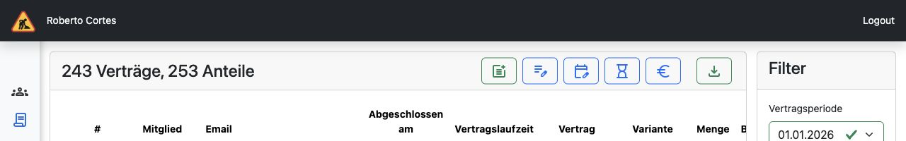

## Screenshots Version 2

Aufgenommen am 19.11.2026 mit generierten lokalen Testdaten (Vertragsart „Brotanteil“).
Der Prototyp-Code ist unverändert; nur die Screenshots wurden ergänzt.

### Die zwei Icons in der Aktionsleiste unter „Verträge“

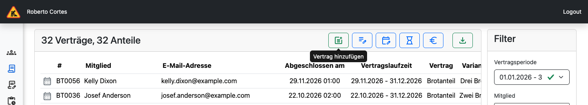

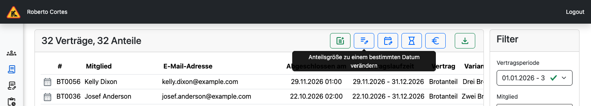

### Icon 1: Vertrag hinzufügen

1. Mitglied suchen und auswählen.

   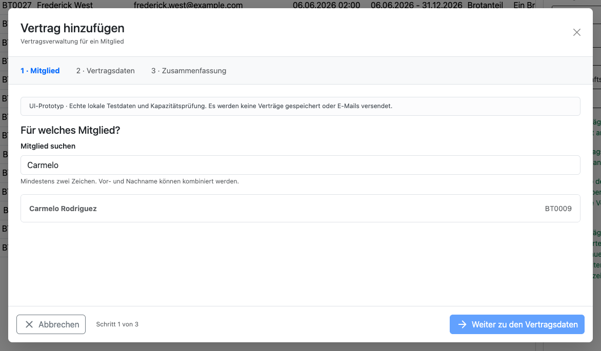

2. Vertragsdaten: Vertragsart, Produktanteilsgröße, Menge, Beginn. Rechts der Status von
   Abholort, Zahlungsintervall und Bankverbindung. Hier fehlt der Abholort (rotes Kreuz),
   deshalb erscheint eine Auswahl mit den Abholorten, die noch Kapazität haben.

   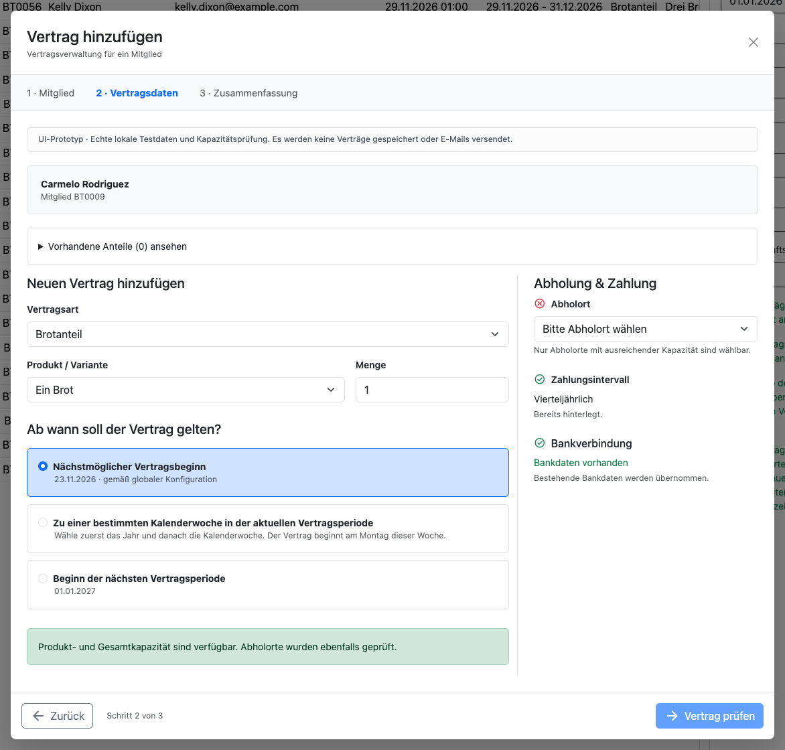

3. Beginn zu einer bestimmten Kalenderwoche (erst Jahr, dann KW mit Montagsdatum),
   Abholort gewählt, Kapazitätsprüfung grün.

   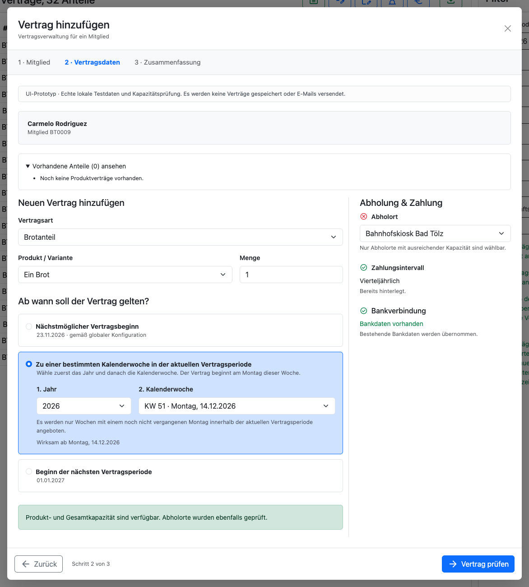

4. Zusammenfassung mit Vorschau für das Mitgliederprotokoll.

   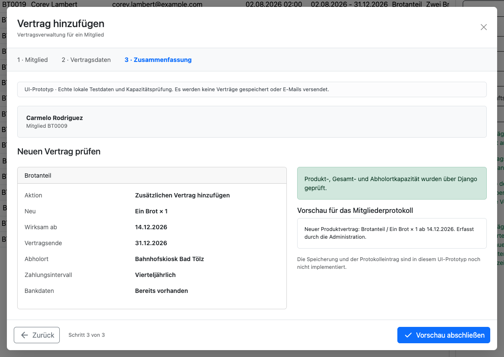

### Icon 2: Anteilsgröße zu einem bestimmten Datum verändern

Die Mitgliedssuche ist dieselbe wie bei Icon 1.

1. Genau einen bestehenden Anteil auswählen. Beendete oder gekündigte Verträge sind
   ausgegraut und nicht wählbar.

   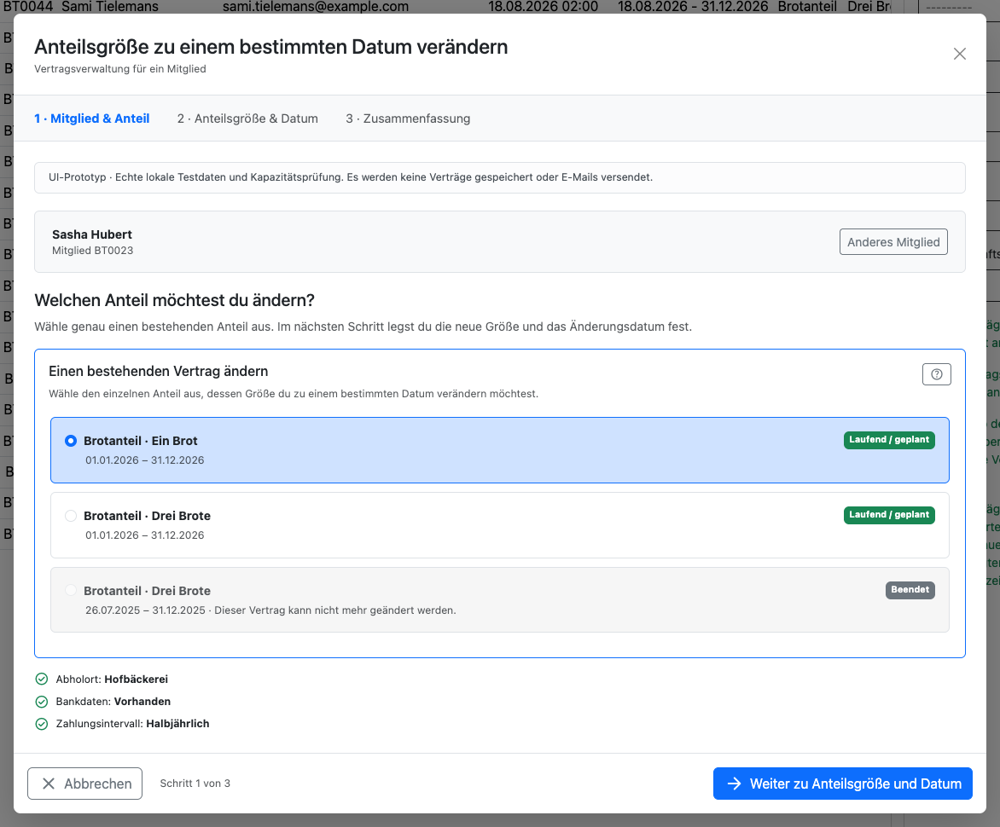

2. Neue Produktanteilsgröße und Wirksamkeitsdatum. Vertragsart gesperrt, kein Mengenfeld.

   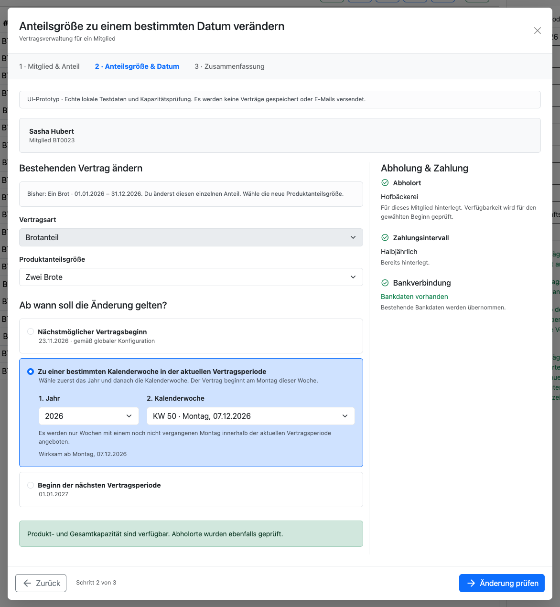

3. Zusammenfassung „Bisher → Neu“ mit Vorschau für das Mitgliederprotokoll.

   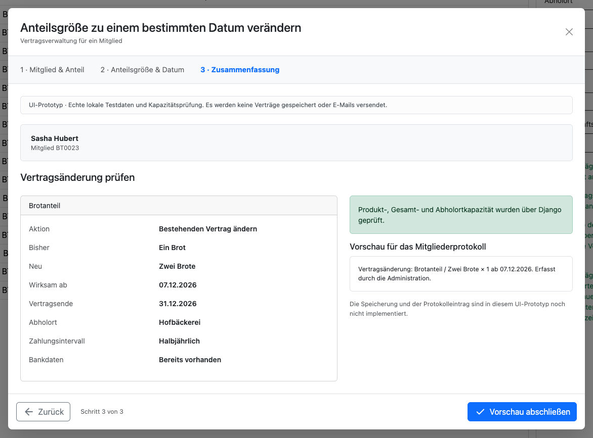

4. Hinweis, wenn der hinterlegte Abholort für die neue Größe keine Kapazität mehr hat:
   „Änderung prüfen“ bleibt gesperrt.

   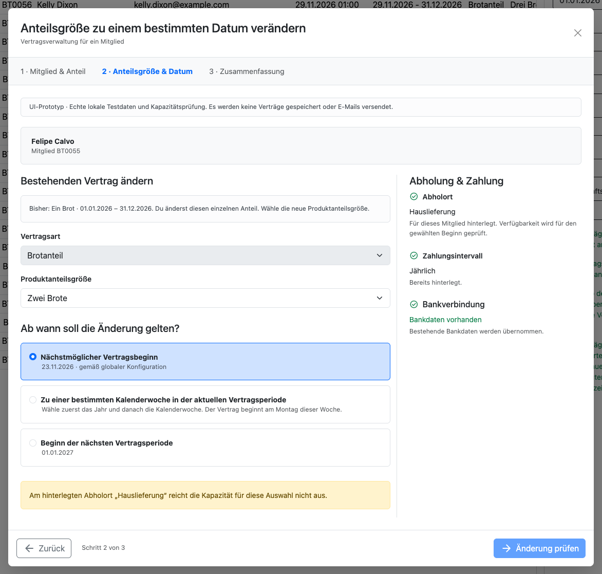

Bekannte Kleinigkeit im Prototyp: Das Status-Icon „Abholort“ bleibt nach der Auswahl
eines Abholorts rot (Screenshot Neuanlage Schritt 3). In der Umsetzung sollte es nach
der Auswahl auf grün wechseln.

## Lokal ansehen

Branch: `codex/issue-1037-admin-contract-prototype-v2`

Nach der üblichen lokalen Einrichtung (`make up`, ggf. `make manage ARGS="migrate"`)
mit einem Testkonto mit `accounts.manage` anmelden und diese Adresse öffnen:

**http://localhost:8000/tapir/contracts?prototype_variant=separate-actions**

Zum Vergleich Version 1 ohne Query-Parameter:
http://localhost:8000/tapir/contracts

Weiterhin nur DEBUG / `accounts.manage`, mit echten lokalen Testdaten und vorhandenen
Kapazitätsdiensten. Die Anleitung und die gemeinsamen fachlichen Regeln stehen in
[der Version-1-Dokumentation](issue-1037.md).

## Icon 1: Vertrag hinzufügen

`post_add` mit Tooltip **„Vertrag hinzufügen“**.

1. Mitglied suchen und auswählen.
2. Direkt die neuen Vertragsdaten eingeben: Vertragsart, Produktanteilsgröße, Menge,
   Beginn und ggf. fehlender Abholort bzw. fehlende Zahlungsdaten.
3. Kapazitätsprüfung und Zusammenfassung.

Es gibt keine zusätzliche Entscheidung zwischen „neu“ und „bestehend“. Die bereits
vorhandenen Anteile sind im Formular als aufklappbare Übersicht verfügbar. Zurück aus
den Vertragsdaten führt wieder zur Mitgliedssuche.

## Icon 2: Anteilsgröße zu einem bestimmten Datum verändern

`edit_note` mit Tooltip **„Anteilsgröße zu einem bestimmten Datum verändern“**.

1. Mitglied suchen und auswählen.
2. Genau einen bestehenden Anteil auswählen. Eine Neuanlage steht hier nicht zur Wahl.
   Ohne einen änderbaren Anteil bleibt „Weiter“ gesperrt.
3. Neue Produktanteilsgröße und Wirksamkeitsdatum wählen. **Kein Mengenfeld**;
   die Vertragsart bleibt gesperrt. Die übrigen Anteile bleiben in der Kapazitätsrechnung enthalten.
4. Kapazitätsprüfung und Zusammenfassung.

Alle gemeinsamen Regeln der Version 1 gelten auch hier: deutsche Jahres-/KW-Auswahl,
Montagsdatum direkt in der Option, kein vergangener Vertragsstart, Status-Icons,
Preis-Kennzeichnungen ohne Beträge und originale Tapir-Hilfekomponente.

## Änderungen gegenüber Version 1

- `SubscriptionListView` setzt den Vergleichsmodus anhand von `prototype_variant=separate-actions`.
- Das vorhandene Vertragslisten-Template zeigt abhängig davon ein gemeinsames oder zwei separate Icons.
- Derselbe Dialog unterstützt die drei UI-Modi `combined`, `new` und `change`.
- Die Datendienste und Kapazitätsprüfungen sind gemeinsam; es wurde kein zweiter fachlicher Backend-Pfad angelegt.

Der Branch baut auf dem veröffentlichten V1-Commit
`5a8b594746b47ca3d24539b1f4ab0f0751e7a871` auf. Der Entwurfs-PR gegen `master`
enthält die vollständige Grundlage; er setzt kein vorheriges Mergen des V1-PRs voraus.

## Prüfung und Grenzen

Beide getrennten Pfade wurden im Browser mit den vorhandenen Django-Testdaten bis zur
Zusammenfassung durchlaufen: Neuanlage für ein Mitglied ohne Vertrag einschließlich
Abholortwahl sowie Änderung eines einzelnen Anteils M → L ohne Mengenfeld.
Auswahlpflicht, gesperrte Vertragsart, eigene Dialogtitel und Schrittbezeichnungen wurden geprüft.
Django-Systemcheck und JavaScript-Syntaxprüfung waren erfolgreich; keine Browser-Konsolenfehler.
Die gemeinsamen Komponenten und die übrigen Dienste wurden bereits bei V1 geprüft.

**Weiterhin ein UI-Prototyp ohne Speichern:** keine neuen oder geänderten Verträge,
keine echten Audit-Einträge, keine E-Mails. Die offenen fachlichen und technischen
Implementierungsarbeiten aus der Version-1-Dokumentation bleiben bestehen.

Langfristig können sämtliche Vertragsaktionen in einem gemeinsamen Verwaltungsdialog
zusammengeführt werden. Diese umfassende Zusammenführung ist eine separate Folgeentwicklung;
Version 2 ist der bevorzugte, zur bestehenden Aktionsleiste passende kurzfristige Einstieg.
