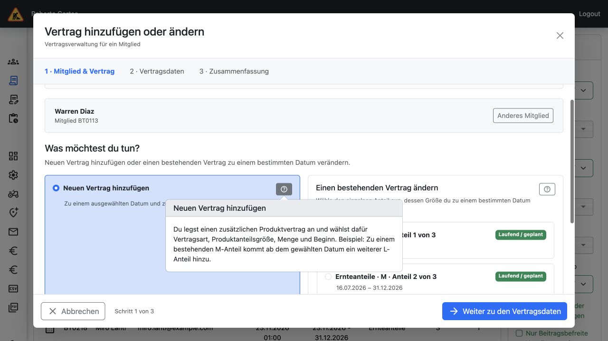
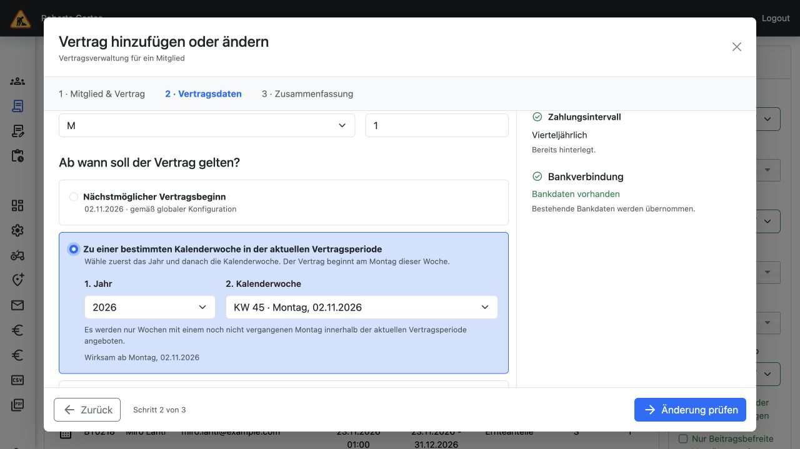

# UI-Prototyp Version 1 – Admin-Verträge (#1037)

Dieser Entwurf wurde mit Marcus im bestehenden Django-Testsystem iteriert.
Er dient als klickbare Vorlage für die Umsetzung, **nicht als fertige Vertragsverwaltung**.
Version 1 hat ein gemeinsames Icon „Vertrag hinzufügen oder bearbeiten“ und anschließend
zwei nebeneinanderliegende Optionen. Eine alternative Version mit zwei separaten Icons
ist nicht Bestandteil dieses Branches.

## Screenshots

### Gemeinsamer Einstieg, zwei Optionen und originale Tapir-Hilfe

### Deutsche Datumswahl: erst Jahr, dann Kalenderwoche

Die Screenshots zeigen ausschließlich generierte lokale Testdaten.

## Lokal ansehen

1. Diesen Branch auschecken und die dokumentierte lokale Entwicklungsumgebung verwenden.
2. `make up` starten; auf einer lokalen Entwicklungsdatenbank `make manage ARGS="migrate"` ausführen.
3. Mit einem bestehenden Testkonto mit `accounts.manage` anmelden. Testkonten und Einrichtung sind in der Projekt-README beschrieben.
4. `http://localhost:8000/tapir/contracts` öffnen und das Dokument-plus-Icon oben rechts anklicken.

Voraussetzungen: DEBUG-Modus, laufender Vite-Server, gültige aktuelle Vertragsperiode,
Produkte und bestehende Mitglieder. Der Einstieg ist nur mit `accounts.manage` sichtbar;
der Vorschau-Endpunkt ist zusätzlich außerhalb von DEBUG gesperrt. Bei einer leeren
Testumgebung können die üblichen Populate-Werkzeuge genutzt werden. Bestehende Daten
müssen für den Prototyp nicht zurückgesetzt werden.

## Abgestimmter Ablauf

- Mitglied nach Vorname, Nachname, Kombinationen, interner ID oder formatierter Mitgliedsnummer suchen.
- Zwei Optionen: **Neuen Vertrag hinzufügen** und **Einen bestehenden Vertrag ändern**.
- Neuanlage: zu einem ausgewählten Datum zusätzlich zu den bestehenden Verträgen;
  Vertragsart, Produktanteilsgröße und ganzzahlige Menge auswählen.
- Änderung: genau einen bestehenden Anteil wählen. Auch ein Datensatz mit mehreren
  Anteilen erscheint als mehrere getrennt auswählbare Einträge. **Kein Mengenfeld**;
  nur die Größe dieses Anteils wird geändert. Die Vertragsart bleibt fest.
- Gekündigte oder beendete Verträge sind nicht auswählbar.
- Bei bestehenden Anteilen ggf. „Personalisierter Betrag“ oder „Beitragsbefreit“ anzeigen;
  keinen Preisbetrag ausgeben (`price_override=None`, ungleich 0 bzw. 0).
- Abholort, Bankdaten und Zahlungsintervall in der Auswahl untereinander anzeigen:
  grünes Häkchen bei vorhandenen Angaben, rotes Kreuz bei fehlenden Angaben.
  Dieselben Status-Icons stehen im Schritt „Vertragsdaten“.
- Fehlende Angaben in der Vorschau ergänzen; fehlende Bankdaten bleiben im Browser.
  Eine IBAN-Prüfziffer wird geprüft.
- Beginn: nächstmöglicher Start gemäß Konfiguration, **„Zu einer bestimmten Kalenderwoche
  in der aktuellen Vertragsperiode“** oder Beginn der nächsten Vertragsperiode.
- Innerhalb der KW-Option: zuerst **Jahr**, danach **Kalenderwoche** wählen. Die KW zeigt
  ihr Montagsdatum. **„Wirksam ab“ steht direkt innerhalb dieser Option**.
  Vergangene Montage werden nicht angeboten und serverseitig abgewiesen.
- Produkt-, Gesamt- und Abholortkapazität anhand der vorhandenen Django-Dienste prüfen.
- Zusammenfassung mit Vorschau für den Protokolleintrag; Abschluss schließt die Vorschau.

## Einstiegspunkte im Code

| Bereich | Datei |
| --- | --- |
| Einstieg in die vorhandene Vertragsliste | `tapir/wirgarten/templates/wirgarten/subscription/subscription_filter.html` |
| Sichtbarkeit im DEBUG-Modus | `tapir/wirgarten/views/contracts.py` |
| Bootstrap-Dialog | `tapir/subscriptions/templates/subscriptions/admin_contract_prototype.html` |
| Interaktion, Zustände und Validierung | `tapir/subscriptions/static/subscriptions/admin_contract_prototype.js` |
| Ergänzende Darstellung | `tapir/subscriptions/static/subscriptions/admin_contract_prototype.css` |
| Originale Tapir-Hilfebuttons | `src_frontend/subscription_list/admin_contract_prototype_help.tsx` |
| Einbindung in vorhandenes React-Island | `src_frontend/subscription_list/subscription_list_entry.tsx` |
| Read-only Daten und Kapazitätsvorschau | `tapir/subscriptions/services/admin_contract_prototype.py` |
| Berechtigungsprüfung und JSON-Antworten | `tapir/subscriptions/views/admin_contract_prototype.py` |
| Route | `tapir/subscriptions/urls.py` |

Es wird die bestehende React-Komponente `TapirHelpButton` verwendet. Der übrige Dialog
basiert auf dem vorhandenen Django-Layout, Bootstrap und dem aktiven Tapir-Theme.
Der Datenendpunkt ist ein normaler Django-View, keine neue DRF-Schnittstelle.

## Bewusst noch offen für die Implementierung

- **Keine Vertrags-Schreiboperationen, keine echten Logeinträge, keine E-Mails.**
- Schreibpfad über bestehende Serviceklassen und Transaktionen implementieren;
  Kapazität, Berechtigung und sämtliche Eingaben beim Speichern erneut prüfen.
- Beim Ändern eines einzelnen Anteils eines Mengen-Datensatzes die anderen Anteile,
  die Historie, die Gültigkeitszeiträume und die bisherigen Preise korrekt erhalten.
- Fachliche Regel für personalisierte bzw. beitragsbefreite Verträge beim Größenwechsel klären.
- Abholort und ggf. fehlende Zahlungs-/Bankdaten zum Wirksamkeitsdatum speichern.
- Bestätigungs-/E-Mail-Prozess und Audit-Protokoll in den vorhandenen Ablauf integrieren.
- Feature-Freischaltung und geeignete Integrations-/Berechtigungs-/Parallelitätstests ergänzen.
- Die Vorschau ersetzt keine abschließende Prüfung der fachlichen Randfälle der vorhandenen Kapazitätsdienste.

## Durchgeführte Prüfungen

- `make frontend-build`: TypeScript und Vite erfolgreich; vorhandene Hinweise zu
  Schriftpfaden und Bundlegröße. JavaScript-Syntaxprüfung, Black und Prettier.
- Django-Systemcheck ohne Befund.
- Im Browser: echte Anmeldung, Namens-/Nummernsuche, Neu- und Änderungspfad,
  einzeln auswählbare Anteile, fehlender Abholort, Kapazitätsfehler, unveränderte
  Menge, Jahres-/KW-Auswahl, Hilfebuttons und Entfernen der Popover beim Schrittwechsel.
- Smoke-Prüfungen gegen die isolierte Testdatenkopie: 3 einzeln auswählbare Anteile,
  Restmenge in der Kapazitätsprüfung erhalten, ungültige Anteilnummer/Menge und
  vergangenes Datum abgewiesen; keine Vertrags-Schreiboperationen (588 Verträge).
- Preis-Kennzeichnungen in einer zurückgerollten Transaktion geprüft; keine Beträge
  in den Vorschau-Daten und keine dauerhaft veränderten Preiswerte.
- Kalenderwochenberechnung zusätzlich am ISO-Jahreswechsel und am Periodenende geprüft.
- Fehlende Bankdaten waren im vorhandenen Testbestand nicht enthalten; dieser
  Eingabepfad ist implementiert, aber noch nicht mit einem entsprechenden DB-Testfall durchgespielt.

Die temporären lokalen Smoke-Prüfungen sind keine vollständige automatisierte Testsuite.
Die UI wurde auf einer isolierten Kopie des vorhandenen Testbestands erprobt. Eine lokale
Docker-Dateifreigabestörung wurde für die Vorführung per Quellsnapshot umgangen; dieser
Umgebungs-Workaround ist kein Bestandteil der fachlichen Implementierung.
