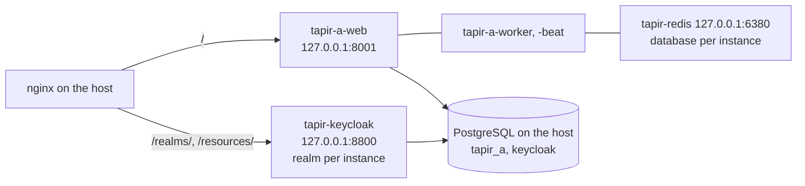

# Debian package and container operation

Tapir runs in production as podman containers under systemd; the Debian package `tapir` (`Architecture: all`,
Debian 13 trixie) only brings the tools and templates.

| Path | Content |
|---|---|
| `/usr/sbin/tapir-instance` | create, upgrade, remove instances (root) |
| `/usr/sbin/tapir-kcadm` | Keycloak administration, realm always explicit (`rwxrwx---` root:root) |
| `/usr/sbin/tapir-manage` | `manage.py` of an instance: `tapir-manage <instance> <args>` |
| `/usr/share/tapir/` | `tapir.env.example`, `nginx-site.conf.in`, realm template and login theme |
| `/etc/tapir/instances/<name>.env` | configuration of an instance (environment of its containers) |
| `/etc/tapir/keycloak.env` | shared Keycloak: database and admin password (root only) |
| `/etc/tapir/initial-passwords/` | initial passwords of created users (root only) |
| `/var/lib/tapir/<name>` | data of an instance (`/data` in the containers: media, uploads, logs, beat schedule) |
| `/var/lib/tapir/keycloak` | Keycloak login theme |
| `/etc/containers/systemd/tapir-*.container` | quadlet units: `tapir-keycloak`, `tapir-redis`, `tapir-<name>-{web,worker,beat}` |
| `/var/lib/tapir/redis` | data of the shared redis (append-only file) |
| `/etc/systemd/system/tapir-<name>.target` | starts/stops all units of an instance |
| `/etc/nginx/sites-available/tapir-<name>` | nginx site of an instance, enabling it is manual |



## Installation

See the README: add the APT repository, `apt install tapir postgresql nginx`. debconf asks for the first instance
(name, host name, port, first admin, image) and runs `tapir-instance create`. Later instances:

```sh
sudo tapir-instance create mysolawi --domain solawi.example.org --port 8010 --admin-email you@example.org
```

`create` is idempotent and ends with checks (units running, Tapir answers, Keycloak issuer, Tapir reaches the
Keycloak admin API, nginx if enabled). Every instance gets its own PostgreSQL role and database `tapir_<name>`,
its own database number in the shared redis container `tapir-redis` (127.0.0.1:6380; `upgrade` also moves older
setups with a redis on the host or per instance over to it) and the realm `<name>` with a generated client secret; the mail server of the
instance (`EMAIL_HOST*` in its env file) is also used by Keycloak.

## nginx and certificates

`/etc/nginx/sites-available/tapir-<name>` proxies `/` to gunicorn and `/realms/`, `/resources/` to Keycloak.
Without certificate it serves HTTP only, enough for

```sh
sudo ln -s /etc/nginx/sites-available/tapir-mysolawi /etc/nginx/sites-enabled/
sudo nginx -t && sudo systemctl reload nginx
sudo certbot certonly --webroot -w /var/www/html -d solawi.example.org
sudo tapir-instance nginx mysolawi     # rewrites the site with HTTPS and reloads nginx
```

An already enabled site of the domain (e.g. written by hand or by certbot) is not replaced: its HTTPS server
block gets `include /etc/nginx/snippets/tapir-keycloak.conf;` and `location /` is pointed to the instance
(backup in `/var/lib/tapir/backup`, `nginx -t`, restore on failure). Delete the first line of a generated site
to keep local changes.

## Keycloak on the command line

```sh
sudo tapir-kcadm realms
sudo tapir-kcadm --realm mysolawi user list
sudo tapir-kcadm --realm mysolawi user passwd someone@example.org          # temporary password
sudo tapir-kcadm --realm mysolawi user role someone@example.org coop.view
sudo tapir-kcadm --realm mysolawi user reset-mail someone@example.org
sudo tapir-kcadm --realm mysolawi raw get clients --fields clientId          # any kcadm.sh command
```

A Keycloak login alone does not open Tapir; staff accounts are created with
`tapir-instance user-add <name> <mail> [--admin]` (Tapir user and Keycloak login). The admin console stays
internal: `ssh -L 8800:127.0.0.1:8800 root@<server>`, http://localhost:8800/admin, user `admin`, password in
`/etc/tapir/keycloak.env`.

## Upgrades

`apt upgrade` updates the tools only. Instances are upgraded explicitly:

```sh
sudo tapir-instance upgrade --all                       # pull the image, migrate, restart, check
sudo tapir-instance upgrade mysolawi --image ghcr.io/foodcoopx/wirgarten-tapir:0.3.0
```

## Images and packages built locally

```sh
podman build -f docker/production/Containerfile --build-arg TAPIR_VERSION=$(git describe --always) -t tapir:local .
sudo tapir-instance upgrade mysolawi --image localhost/tapir:local
packaging/build-deb.sh 0.2.0+local1         # -> build-deb/tapir_*_all.deb
```

## CI / APT repository

`.github/workflows/debian-package.yml` (manual or on `v*` tags) builds and pushes the production image to
`ghcr.io/<owner>/<repo>` (tags: version, `latest` on `v*` tags, `edge`, `sha-…`), builds the `.deb`,
attaches it to a `deb-<version>` prerelease and publishes a signed APT repository
with the latest `KEEP_VERSIONS` packages to GitHub Pages. One-time setup:

1. Settings → Pages → Source: **GitHub Actions**
2. Create a signing key without passphrase and store it as secret `APT_GPG_PRIVATE_KEY`:
   ```sh
   gpg --batch --passphrase '' --quick-gen-key "Tapir APT <apt@example.org>" ed25519 sign never
   gpg --armor --export-secret-keys "Tapir APT" | gh secret set APT_GPG_PRIVATE_KEY
   ```
